# CoopPilot — An AI Agent for Tailoring Co-op Applications

**EECS 3311 Software Design — Fall 2026 — Course Project, Stage 1 (Design)**
**Author:** Sina Akhavansafar — Student # 221 497 433 (solo project)
**Language / platform:** Java 21, Spring Boot 3 + Thymeleaf (web GUI), picocli (CLI), SQLite (Spring JDBC)
**LLM:** Anthropic Claude via the Messages API with tool use

> All diagrams were made with **UMLet**. The editable sources are the `.uxf` files in [`diagrams/`](diagrams/); the PNGs shown below are rendered from them.

## Contents

1. [Project Overview](#1-project-overview)
2. [Feature Specifications](#2-feature-specifications)
3. [UML Class Diagram](#3-uml-class-diagram)
4. [Design Patterns](#4-design-patterns)
5. [Use-Case Diagram](#5-use-case-diagram)
6. [Use-Case Descriptions](#6-use-case-descriptions)
7. [Sequence Diagrams](#7-sequence-diagrams)
8. [Feature-to-Design Traceability Table](#8-feature-to-design-traceability-table)
9. [How Each Feature Is Realized](#9-how-each-feature-is-realized)
10. [Key Design Decisions](#10-key-design-decisions)

---

## 1. Project Overview

### 1.1 Problem and motivation

Students looking for co-op terms apply to dozens of postings per term through the school's job board, LinkedIn and company sites. Each posting asks for something slightly different, and applicant tracking systems (ATS) filter resumes by literal keyword matches. Tailoring a resume and cover letter properly takes 30–60 minutes per posting, so most students send one generic resume everywhere. In my own previous co-op search I applied to about 30 postings with a mostly generic resume and got no responses.

General-purpose chatbots do not solve this well:

- they **invent experience** (numbers, tools, team sizes) that the student never had;
- they do not know the student's full history, so every chat starts from zero;
- they ignore hard formatting constraints (one page, reverse-chronological order, the student's LaTeX template);
- they do not keep track of what was sent where.

This project grows out of a browser-based prototype workflow I used during my own Winter 2027 search. CoopPilot is a **new design from scratch** in Java, built as a tool-using agent instead of a fixed pipeline.

### 1.2 Target users

- **Primary:** university students applying to co-op and internship positions (especially in software and engineering) who maintain a LaTeX resume.
- **Secondary:** new graduates applying to many entry-level roles.

### 1.3 What the agent does

Given a job posting, the agent:

1. analyzes the posting into must-haves, nice-to-haves and ATS keywords;
2. compares it with the student's **Experience Vault** (a structured memory of projects, jobs, courses and skills);
3. **decides on its own** whether to reuse a saved resume, tweak one, or build a new one;
4. calls tools to search the vault, scan keyword coverage, assemble LaTeX, estimate page length and condense;
5. **asks the student** when a fact is missing instead of guessing, and files the answer back into the vault;
6. produces a one-page tailored resume (and a cover letter on request), which the student can revise in plain English, undo, export and log as an application.

### 1.4 Why an agent is appropriate

Tailoring is not a fixed sequence. The right steps depend on the posting and on what is already in the vault:

- a posting that closely matches a saved resume needs only a keyword check;
- a posting in a new role family needs vault searches and a fresh build;
- a draft that runs over one page needs condensing, and a missing fact needs a question.

Hard-coding every path leads to a large, brittle decision tree. In CoopPilot the LLM plans the steps and chooses among **deterministic tools**. The tools enforce the rules that must never be broken: ordering, formatting, page budget and "only facts from the vault". The LLM handles judgment (relevance, wording); the code handles correctness.

### 1.5 AI / LLM models

| Use | Model | Access |
|---|---|---|
| Agent reasoning and tool selection, posting analysis, cover letters, revisions, smart condense | Anthropic Claude (Sonnet-class model; the exact model ID is set in `config.properties` and will be recorded in Stage 2) | Anthropic Java SDK, Messages API with native tool use |
| Offline development / cost-free runs (optional) | A local model served through an OpenAI-compatible endpoint (e.g. Ollama) | `OpenAiCompatibleAdapter` |
| Automated tests | `MockLlmClient` returning scripted responses | In-process |

### 1.6 How the AI interacts with the rest of the system

```
Browser (Thymeleaf pages)
   │  HTTP + SSE
Spring MVC controllers ─┐
                        ├─> CoopPilotFacade ─> AgentController ──(LlmRequest)──> LLMClient ──> Claude API
CLI (picocli)  ─────────┘          │                 │   ^                         (Adapter)
                               │                 │   └──(LlmResponse: tool calls)
                               │                 v
                               │            ToolRegistry ──> Tools ──> deterministic services
                               │                                       (VaultService, KeywordScanner,
                               │                                        LatexAssembler, PageEstimator, ...)
                               v
                    ApplicationTracker, DashboardService, Repositories (SQLite)
```

- The LLM **never writes to storage or files directly**. It can only act through tools registered in the `ToolRegistry`, which validates every argument against the tool's JSON schema before running it.
- Each tool returns a `ToolResult` that is appended to the `AgentSession` and sent back to the LLM on the next step (a reason–act–observe loop).
- The loop stops when the LLM calls `save_resume` and returns a final answer, or when `maxSteps` is reached.
- Single-shot LLM jobs (posting analysis, cover letter, revision) go through `LlmTask<T>` subclasses, which share retry and output-validation logic.
- The web GUI is a Spring Boot application with server-rendered Thymeleaf pages. Spring MVC controllers handle each page and call the same `CoopPilotFacade` as the CLI, so every feature works in both. While the agent runs, progress and questions reach the browser through Server-Sent Events (SSE); this is the only part of the GUI that needs a small amount of JavaScript.
- The CLI's `--json` mode prints a machine-readable result, which Stage 3 will use to drive the agent from KUMA (a Python SDK).

### 1.7 Technology stack

Java 21 · Spring Boot 3 (Spring MVC, dependency injection) · Thymeleaf · picocli · Jackson (JSON) · SQLite via Spring JDBC (`JdbcTemplate`) · Anthropic Java SDK · JUnit 5 + Mockito (Stage 3) · Maven · UMLet (diagrams).

---

## 2. Feature Specifications

Type legend: **D** = deterministic, **AI** = LLM-based, **H** = hybrid.

### F01 — Experience Vault and Resume Import (D)

- **Description:** Stores the student's experience as structured `VaultEntry` items (project, work, course, activity, skill, planned) with tags and a usage scope (`ALL`, `LETTERS_ONLY`, `CONTEXT_ONLY`). Imports an existing Jake's-template LaTeX resume and splits it into reusable `ResumeBlock`s. This is the agent's long-term memory.
- **User interaction:** *Vault* page → "Import .tex", or "Add entry" form; list with search and tag filters. CLI: `coop vault import resume.tex`, `coop vault add`.
- **Input:** a LaTeX file, or entry fields (title, kind, use, date, tags, body).
- **Output:** saved blocks and vault entries, plus a list of parse warnings.
- **Workflow:** `LatexResumeParser` scans `\resumeSubheading` / `\resumeProjectHeading` commands → builds blocks → `VaultService` creates matching entries → repositories save them.
- **Error cases:** malformed entry → skipped with a warning; no recognizable entries → "Not a supported template" error; duplicate skill (case or spacing variant) → rejected with a message.

### F02 — Job Posting Import and Analysis (H)

- **Description:** Turns raw posting text into a structured `PostingAnalysis`: company, role, term, deadline, must-haves, nice-to-haves, ATS keywords with aliases, required documents, and a "soft-skill focus" flag.
- **User interaction:** *Posting* page → paste text (or load a `.txt`/`.json` export) → "Analyze". CLI: `coop analyze posting.txt`.
- **Input:** posting text.
- **Output:** a saved `Posting` with its `PostingAnalysis`, shown as editable fields.
- **Workflow:** `PostingAnalysisTask.run()` builds a prompt asking for strict JSON → LLM → parse → validate (required fields present, keywords non-empty) → save.
- **Error cases:** invalid JSON or missing fields → retried up to 2 times, then the user can fill the fields manually; empty text → rejected before any LLM call; LLM unavailable → error message, posting kept as raw text.

### F03 — Fit Analysis and Skill-Gap Detection (H)

- **Description:** Scores how well the student fits the posting (0–100), lists matched requirements and gaps, finds the closest saved resume, and recommends a strategy: **REUSE**, **TWEAK** or **GENERATE**.
- **User interaction:** *Posting* page → fit panel appears after analysis (score, gap list, recommended strategy).
- **Input:** `PostingAnalysis` and the vault's skills.
- **Output:** a `FitReport`.
- **Workflow:** `FitScorer.score()` matches must-haves and keywords against vault skills (deterministic). `ResumeLibrary.findClosest()` ranks saved resumes. The facade picks the strategy from the thresholds (≥ 75% → reuse). The LLM's role is the posting analysis from F02, which feeds the scorer.
- **Error cases:** empty vault → score 0 and a prompt to import a resume first; posting not yet analyzed → "Analyze first".

### F04 — ATS Keyword Coverage Scan (D)

- **Description:** Checks which posting keywords literally appear in a resume, as an ATS would. Each keyword is classified as **backed** (on the resume and supported), **thin** (on the resume, weak evidence), **known but not worded** (in the vault, not on the resume) or **missing**.
- **User interaction:** coloured keyword chips under the resume preview; the chips refresh after every edit.
- **Input:** a `Resume` and a `PostingAnalysis`.
- **Output:** a `KeywordReport` with a coverage percentage.
- **Workflow:** normalize text → match each keyword and its aliases with word-boundary rules → cross-check the vault for the "known but not worded" class.
- **Error cases:** keyword list empty → coverage shown as "n/a"; LaTeX commands are stripped before matching so `\textbf{Java}` still counts.

### F05 — Agentic Resume Tailoring (AI)

- **Description:** The core agent. Given the goal "tailor a resume for posting P", the LLM plans and executes a sequence of tool calls (find similar resume, keyword scan, search vault, compose resume, estimate page, condense, ask user, save) until it produces a one-page tailored resume.
- **User interaction:** *Tailor* page → "Tailor resume". A live step log (pushed over SSE) shows each tool the agent calls. CLI: `coop tailor --posting p.txt [--json]`.
- **Input:** posting ID, vault, saved resumes and blocks, LaTeX template.
- **Output:** a saved `Resume` named `CV_Company_Role`, an `AgentResult` (status, summary, step count) and the tool log.
- **Workflow:** see SD01. `AgentController.run()` loops: build request → `LLMClient.complete()` → for each tool call, `ToolRegistry.execute()` → append the result → repeat. The system prompt carries the rules: only vault facts, unknown numbers as placeholders like `[N=5]`, reverse-chronological experience, one page.
- **Error cases:** invalid tool arguments → the tool is not run and an error result goes back to the LLM; unknown tool name → error result; step limit (default 15) → partial draft returned with status `STEP_LIMIT`; LLM/API failure → retry with backoff, then `FAILED`.

### F06 — Clarifying Questions and Vault Learning (H)

- **Description:** When the agent needs a fact that is not in the vault (a framework, a date, a team size), it calls `ask_user` instead of guessing. The answer is rewritten into a clean vault entry, so the agent never has to ask again (memory).
- **User interaction:** a dialog on the *Tailor* page (question pushed over SSE, answer POSTed back); a stdin prompt in the CLI (`--no-input` skips questions).
- **Input:** the agent's question; the student's answer, or a skip.
- **Output:** a `ToolResult` for the agent, plus a new or updated `VaultEntry`.
- **Workflow:** see SD02. `AskUserTool` → `QuestionHandler.ask()` (`WebQuestionHandler` waits for the browser's answer) → `VaultService.fileAnswer()` → save.
- **Error cases:** student skips, or no answer within 5 minutes → the tool returns `UNKNOWN` and the agent must omit the fact or use a placeholder; the agent asks the same question twice → `AskUserTool` returns the earlier answer from the session.

### F07 — One-Page Fitting (Estimate and Condense) (H)

- **Description:** Estimates how much of a page a resume uses and shrinks it to fit. **Quick condense** (rule-based, free) removes the content least relevant to the posting in a fixed order: irrelevant projects first, jobs last. **Smart condense** (1 LLM call) tightens wording and merges bullets.
- **User interaction:** a page meter on the resume preview; "Quick condense" and "Smart condense" buttons; the agent also calls it automatically during F05.
- **Input:** `Resume`, `PostingAnalysis`, mode.
- **Output:** a shortened `Resume` (≤ 98% of the estimated page).
- **Workflow:** `PageEstimator.estimate()` sums line costs per block → the chosen `CondenseStrategy.condense()` → re-estimate until it fits.
- **Error cases:** cannot fit without dropping all projects → stops at the minimum (2 projects, 1 bullet per job) and warns; Smart condense output fails validation (changed facts) → falls back to Quick condense.

### F08 — Natural-Language Revision with Version History (H)

- **Description:** The student types a change ("make the Tim Hortons bullet about teamwork", "drop the oldest project"). The LLM rewrites the resume using only vault facts. Every change, AI or manual, is a command that can be undone and redone, with a "What changed" diff.
- **User interaction:** an "Adjust" chat box on the *Tailor* page; Undo/Redo buttons; pencil icons for manual bullet edits.
- **Input:** a resume and an instruction (or a manual edit).
- **Output:** a revised `Resume`, a diff and an over-page warning.
- **Workflow:** see SD04. `RevisionHistory.execute(new AiRevisionCommand(...))` → `RevisionTask.run()` → validate → push to the undo stack.
- **Error cases:** revision changes dates or titles, or adds facts not in the vault → rejected and the original kept; undo with an empty history → no-op.

### F09 — Cover Letter Drafting (AI)

- **Description:** Writes a cover letter for the posting, grounded in the tailored resume and the vault entries marked `ALL` or `LETTERS_ONLY`. It states the term length the posting asks for.
- **User interaction:** *Tailor* page → "Write cover letter" → editable text area → export. CLI: `coop letter --posting ID --resume NAME`.
- **Input:** posting, resume, relevant vault entries.
- **Output:** a `CoverLetter` saved as `CL_Company_Role`.
- **Workflow:** see SD05. `VaultService.search()` → `CoverLetterTask.run()` → validate (company and role named, 250–400 words, no `CONTEXT_ONLY` facts) → save.
- **Error cases:** validation fails after retries → the last draft is shown with the problems highlighted; LLM unavailable → error.

### F10 — Resume Library, Reuse and Export (D)

- **Description:** Keeps all saved resumes grouped by role family. For a new posting it suggests the closest saved resume (skill overlap 65% + role-family similarity 35%) and offers "Use as-is" when the match is ≥ 75%. Exports `.tex` files with consistent names (`CV_Company_Role`, `CL_Company_Role`) for compiling in Overleaf.
- **User interaction:** *Library* panel with family groups; "Use as-is" and "Export" buttons (export downloads the `.tex`). CLI: `coop export NAME --dir out/`.
- **Input:** posting analysis; resume and target folder.
- **Output:** a renamed resume copy; a written `.tex` path.
- **Workflow:** see SD06.
- **Error cases:** no match ≥ 75% → suggest Tailor instead; resumes containing `[placeholders]` are never suggested; write failure → error with the path.

### F11 — Application Tracking with Status Lifecycle (D)

- **Description:** Logs each application (company, role, resume and cover letter used, date, link) and moves it through a lifecycle: *To apply → Applied → Assessment → Interview → Offer / Rejected / Ghosted*. Illegal transitions are blocked. Setting *Applied* schedules a follow-up date (+10 days).
- **User interaction:** *Tracker* page table with a status dropdown; "Log application" after tailoring. CLI: `coop track APP_ID interview`.
- **Input:** application fields; status events.
- **Output:** updated `Application`; follow-ups-due list.
- **Workflow:** see SD07. `ApplicationTracker.updateStatus()` → `Application.handle(event)` → the current `ApplicationState` decides the transition → save → notify listeners.
- **Error cases:** illegal transition (e.g. Rejected → Offer) → `IllegalStateTransitionException` and a message; unknown application ID → not found.

### F12 — Progress Dashboard and Goals (D)

- **Description:** Shows daily and weekly application goals and progress, total applied, response rate, interviews, follow-ups due and the daily-goal streak. Always reflects the latest application changes.
- **User interaction:** *Dashboard* page with tiles and a weekly bar chart; goals editable inline. CLI: `coop stats`.
- **Input:** all applications, goals, today's date.
- **Output:** `DashboardStats`.
- **Workflow:** `DashboardService` observes `ApplicationTracker` and invalidates its cached stats on every change; `DashboardController` calls `CoopPilotFacade.dashboard()` → `DashboardService.stats(today)`, which recomputes when needed.
- **Error cases:** no applications → zeros and an empty-state message; goal ≤ 0 → rejected.

---

## 3. UML Class Diagram

For readability, the class diagram is split into three views that share class names. Together they form one model. Interfaces are marked «interface»; pattern roles are shown as stereotypes.

### 3.1 Agent core, tools and LLM layer

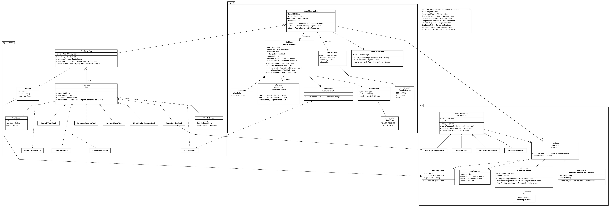

### 3.2 Domain model and deterministic services

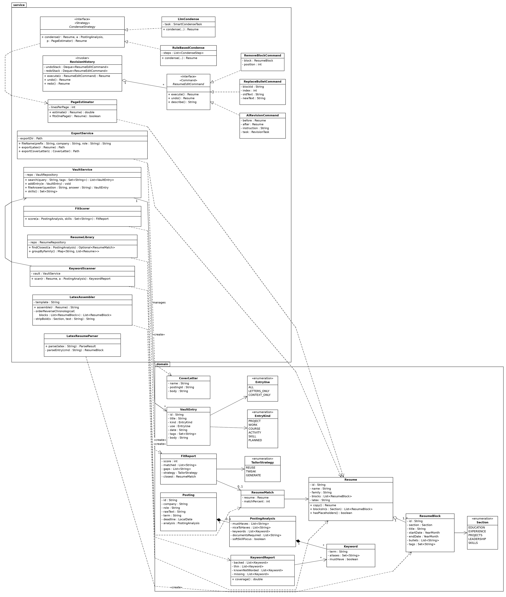

### 3.3 Web (Spring MVC), CLI, facade, application tracking and persistence

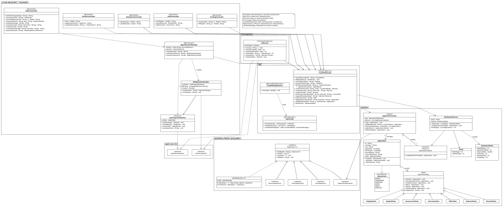

### 3.4 Design principles applied

| Principle | Where |
|---|---|
| **Abstraction / interfaces** | `LLMClient`, `Tool`, `CondenseStrategy`, `ResumeEditCommand`, `Repository<T>`, `QuestionHandler` |
| **Dependency inversion** | `AgentController` depends on `LLMClient` and `Tool`, never on the Anthropic SDK or concrete tools; services depend on repository interfaces, not SQLite. Spring's dependency injection (`AppConfig`) wires the concrete classes in one place |
| **Separation of concerns** | Layers: web controllers / CLI → facade → agent / services → domain → persistence. The LLM decides *what* to do; deterministic services decide *how* and enforce the rules |
| **High cohesion** | Each service does one job (`KeywordScanner` only scans, `PageEstimator` only estimates, `LatexAssembler` only renders) |
| **Low coupling** | Web controllers and the CLI only know `CoopPilotFacade`; tools only know the service they wrap |
| **Encapsulation** | `Application` state can only change through `handle(event)`; `RevisionHistory` owns its stacks |
| **Polymorphism** | `ToolRegistry` executes any `Tool`; `ApplicationState` subclasses define their own transitions |

---

## 4. Design Patterns

Seven patterns are used. Each one solves a specific problem in this application.

### 4.1 Strategy — interchangeable condense algorithms

- **Problem:** fitting a resume to one page can be done cheaply with fixed rules or more cleverly with the LLM. The agent, the web page buttons and the CLI all need to call "condense" without knowing which algorithm runs.
- **Participants:** `CondenseStrategy` (strategy interface); `RuleBasedCondense`, `LlmCondense` (concrete strategies); `CondenseTool` and `CoopPilotFacade` (contexts).
- **Why appropriate:** the algorithms share one signature but differ in cost and behaviour, and the choice happens at run time (the button pressed, or the mode argument the agent passes).
- **Without it:** `if (mode == QUICK) ... else ...` branches would be repeated in the tool, the facade and the CLI, and adding a third algorithm (e.g. "drop oldest first") would mean editing all of them.

### 4.2 Command — undoable resume edits

- **Problem:** a resume is changed by AI revisions, manual bullet edits and block removals. The student must be able to undo and redo any of them in order and see what each one did.
- **Participants:** `ResumeEditCommand` (command); `AiRevisionCommand`, `ReplaceBulletCommand`, `RemoveBlockCommand` (concrete commands); `RevisionHistory` (invoker with undo/redo stacks); `Resume` (receiver); `CoopPilotFacade` (client).
- **Why appropriate:** each edit becomes an object that stores what it needs to reverse itself (before/after snapshot or old/new text), so the history treats all edits the same way.
- **Without it:** undo would need special-case code per edit type, and AI revisions (expensive, non-repeatable) could not be reverted reliably.

### 4.3 Adapter — provider-independent LLM access

- **Problem:** the Anthropic SDK and OpenAI-compatible APIs use different request and response formats, especially for tool calls. The agent must not depend on either.
- **Participants:** `LLMClient` (target); `ClaudeAdapter`, `OpenAiCompatibleAdapter` (adapters); `AnthropicClient` / HTTP endpoint (adaptees); `AgentController`, `LlmTask` (clients).
- **Why appropriate:** the adapters translate our `LlmRequest`/`LlmResponse`/`ToolCall` types to and from each provider's format. `MockLlmClient` implements the same interface for deterministic tests.
- **Without it:** SDK classes would leak into the agent loop, switching models would touch many classes, and the agent could not be unit-tested without network calls.

### 4.4 Observer — live progress and dashboard updates

- **Problem:** (a) while the agent runs, the browser shows a live step log and the CLI prints progress, but the agent core must not know about either UI; (b) the dashboard statistics must stay correct whenever any application changes.
- **Participants:** subjects `AgentSession` (one per agent run) and `ApplicationTracker`; observer interfaces `AgentEventListener` and `ApplicationListener`; concrete observers `SseProgressPublisher` (pushes each step to the browser as an SSE event), `CliRunner` (prints to stderr) and `DashboardService` (invalidates its cached stats).
- **Why appropriate:** one-to-many notification with no compile-time dependency from the core on the UI.
- **Without it:** the agent loop would call web or console code directly (breaking whichever UI it was not written for), and the dashboard would recompute everything on every page load.

### 4.5 State — application lifecycle

- **Problem:** what an application can do next depends on its status (you cannot get an offer for a posting you never applied to, and a rejected application cannot move to interview). Entering *Applied* must also schedule a follow-up.
- **Participants:** `Application` (context); `ApplicationState` (abstract state); `ToApplyState`, `AppliedState`, `AssessmentState`, `InterviewState`, `OfferState`, `RejectedState`, `GhostedState` (concrete states).
- **Why appropriate:** each state holds its own transition rules and entry actions. Unsupported events fall through to the base class, which throws `IllegalStateTransitionException`.
- **Without it:** a large `switch(status)` with nested conditions would be duplicated wherever status changes, and adding a status (e.g. "Second interview") would touch all of them.

### 4.6 Facade — one entry point for the web UI and CLI

- **Problem:** a user action like "tailor a resume" involves the agent, vault, library, repositories and listeners. Two different UIs need the same features.
- **Participants:** `CoopPilotFacade` (facade); subsystems `AgentController`, `VaultService`, `ResumeLibrary`, `FitScorer`, `KeywordScanner`, `RevisionHistory`, `ApplicationTracker`, `DashboardService`, `ExportService`; clients the Spring MVC controllers (`VaultController`, `PostingController`, `TailorController`, `TrackerController`, `DashboardController`) and `CliRunner`.
- **Why appropriate:** keeps the UIs thin and identical in capability. The CLI's `--json` mode becomes a cheap test entry point for Stage 3.
- **Without it:** orchestration logic would be duplicated in the web controllers and CLI commands and would drift apart.

### 4.7 Template Method — single-shot LLM tasks

- **Problem:** posting analysis, cover letters, revisions and smart condense all follow the same steps: build a request, call the LLM, parse the output, validate it, and retry on invalid output. Only the prompt, parsing and validation differ.
- **Participants:** `LlmTask<T>` (abstract class with final `run()`); `PostingAnalysisTask`, `CoverLetterTask`, `RevisionTask`, `SmartCondenseTask` (concrete classes overriding `buildRequest()`, `parse()`, `validate()`).
- **Why appropriate:** the retry and validation policy, which guards against malformed or hallucinated output, is written once and cannot be skipped by a subclass.
- **Without it:** each task would re-implement retries slightly differently, and one forgotten validation would let invented facts through.

*Also used, not counted:* **MVC** through Spring MVC (Thymeleaf views, `@Controller` classes, model attributes), the **Repository** pattern for persistence, and **dependency injection** via Spring (`AppConfig`).

---

## 5. Use-Case Diagram

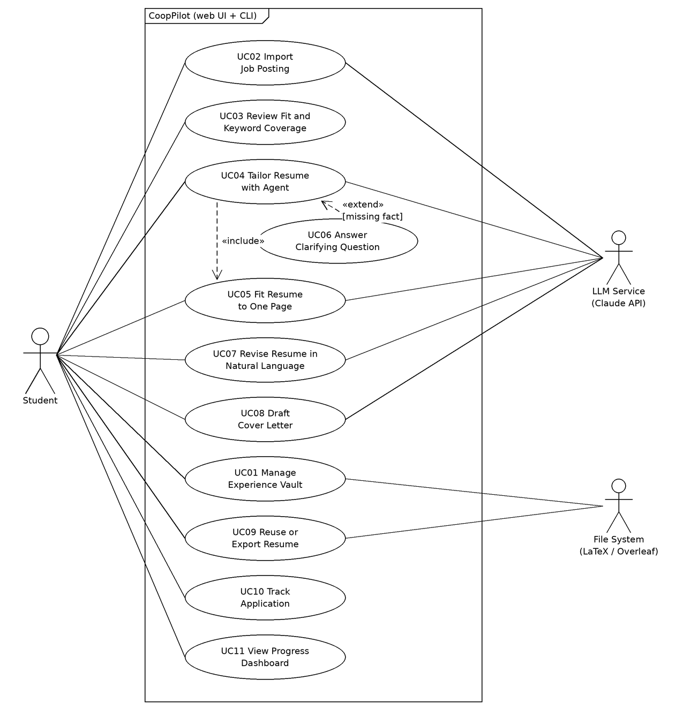

**Actors:**

- **Student** (primary) — uses the web UI (in a browser) or the CLI.
- **LLM Service (Claude API)** (secondary, external) — performs reasoning and text generation.
- **Local file system** (external) — source of imported `.tex` files and destination of exports compiled in Overleaf.

The `<<include>>` from UC04 to UC05 shows that every tailoring run ends by fitting the resume to one page. The `<<extend>>` from UC06 to UC04 shows that a clarifying question happens only when the agent finds a missing fact.

---

## 6. Use-Case Descriptions

### UC01 — Manage Experience Vault

| Field | Description |
|---|---|
| **Actors** | Student; Local file system |
| **Goal** | Build and maintain the vault the agent uses as memory |
| **Preconditions** | Application running; database available |
| **Trigger** | Student clicks "Import .tex" or "Add entry" |
| **Main success scenario** | 1. Student chooses a `.tex` resume. 2. System parses it into blocks. 3. System creates vault entries for each block. 4. System shows imported items and any warnings. 5. Student edits or adds entries (title, kind, use, tags, body). 6. System saves them. |
| **Alternative / exception flows** | 2a. File is not a supported template → error, nothing saved. 2b. Some entries malformed → skipped, listed as warnings. 5a. Duplicate skill → rejected with message. |
| **Postconditions** | Vault and block library contain the new entries |
| **Related features** | F01 |

### UC02 — Import Job Posting

| Field | Description |
|---|---|
| **Actors** | Student; LLM Service |
| **Goal** | Get a structured analysis of a posting |
| **Preconditions** | LLM configured (API key) |
| **Trigger** | Student pastes text and clicks "Analyze" |
| **Main success scenario** | 1. Student pastes posting text. 2. System sends it to the LLM for structured extraction. 3. System validates the JSON. 4. System saves the posting and shows the fields. |
| **Alternative / exception flows** | 1a. Empty text → rejected. 3a. Invalid output → retried up to 2 times; then the student fills the fields manually. 2a. LLM unavailable → error; raw posting saved. |
| **Postconditions** | `Posting` with `PostingAnalysis` saved |
| **Related features** | F02 |

### UC03 — Review Fit and Keyword Coverage

| Field | Description |
|---|---|
| **Actors** | Student |
| **Goal** | Decide whether and how to apply |
| **Preconditions** | Posting analyzed (UC02); vault not empty |
| **Trigger** | Analysis completes, or student opens the fit panel |
| **Main success scenario** | 1. System scores fit against vault skills. 2. System finds the closest saved resume. 3. System scans that resume's keyword coverage. 4. System shows the score, gaps, keyword chips and recommended strategy (Reuse / Tweak / Generate). |
| **Alternative / exception flows** | 1a. Vault empty → score 0, prompt to import. 2a. No saved resumes → strategy GENERATE, no coverage shown. |
| **Postconditions** | `FitReport` shown; nothing changed in storage |
| **Related features** | F03, F04 |

### UC04 — Tailor Resume with Agent

| Field | Description |
|---|---|
| **Actors** | Student; LLM Service |
| **Goal** | Get a one-page resume tailored to the posting, using only true facts |
| **Preconditions** | Posting analyzed; vault has entries; LaTeX template set |
| **Trigger** | Student clicks "Tailor resume" (or runs `coop tailor`) |
| **Main success scenario** | 1. System starts an agent session with the goal and rules. 2. Agent asks the LLM for the next step. 3. LLM chooses a tool (e.g. find similar resume, keyword scan, search vault, compose resume). 4. System validates the arguments and runs the tool, showing it in the step log. 5. Steps 2–4 repeat; the agent fits the resume to one page (**include** UC05). 6. Agent saves the resume. 7. System shows the resume, keyword chips and step log. |
| **Alternative / exception flows** | 3a. Agent needs a missing fact → **extend** UC06. 4a. Invalid tool arguments → error returned to the agent, which retries differently. 5a. Step limit reached → partial draft shown with a warning. 2a. LLM unavailable after retries → error; no resume saved. |
| **Postconditions** | Resume `CV_Company_Role` saved; tool log stored in the session |
| **Related features** | F05, F07 |

### UC05 — Fit Resume to One Page

| Field | Description |
|---|---|
| **Actors** | Student (or the agent, through UC04); LLM Service (smart mode only) |
| **Goal** | Make the resume fit on one page without losing the most relevant content |
| **Preconditions** | A resume is open |
| **Trigger** | Page meter > 100% and the student clicks Quick/Smart condense, or the agent calls `condense` |
| **Main success scenario** | 1. System estimates page usage. 2. System applies the selected condense strategy. 3. System re-estimates until the resume is ≤ 98% of a page. 4. System shows the result and what was removed. |
| **Alternative / exception flows** | 2a. Smart output changes facts → falls back to Quick. 3a. Minimum content reached and still over → stop with a warning. |
| **Postconditions** | Resume fits one page (or the student is warned) |
| **Related features** | F07 |

### UC06 — Answer Clarifying Question

| Field | Description |
|---|---|
| **Actors** | Student |
| **Goal** | Give the agent a missing fact so it does not guess |
| **Preconditions** | UC04 running; agent called `ask_user` |
| **Trigger** | A question dialog (web page) or prompt (CLI) appears |
| **Main success scenario** | 1. System shows the agent's question. 2. Student answers. 3. System files the answer into the vault (new or updated entry). 4. Agent continues with the answer. |
| **Alternative / exception flows** | 2a. Student skips → agent receives `UNKNOWN` and must omit the detail or use a placeholder. |
| **Postconditions** | Vault updated (main flow) |
| **Related features** | F06 |

### UC07 — Revise Resume in Natural Language

| Field | Description |
|---|---|
| **Actors** | Student; LLM Service |
| **Goal** | Change a resume by describing the change, with the option to undo |
| **Preconditions** | A resume is open |
| **Trigger** | Student types an instruction and clicks "Revise" |
| **Main success scenario** | 1. Student enters an instruction. 2. System creates a revision command and runs it. 3. LLM returns the revised resume. 4. System validates it (same dates and titles, no new facts). 5. System shows the diff and page meter. 6. Student may click Undo/Redo. |
| **Alternative / exception flows** | 4a. Validation fails → original kept, error shown. 5a. Over one page → warning with condense buttons. 6a. Nothing to undo → no-op. |
| **Postconditions** | Revised resume current; previous version on the undo stack |
| **Related features** | F08 |

### UC08 — Draft Cover Letter

| Field | Description |
|---|---|
| **Actors** | Student; LLM Service |
| **Goal** | Get a cover letter grounded in real experience |
| **Preconditions** | Posting analyzed; a resume exists for it |
| **Trigger** | Student clicks "Write cover letter" |
| **Main success scenario** | 1. System gathers relevant vault entries (not `CONTEXT_ONLY`). 2. LLM drafts the letter. 3. System validates it (company, role, term length, length). 4. System saves it as `CL_Company_Role` and shows it for editing. |
| **Alternative / exception flows** | 3a. Validation fails after retries → last draft shown with problems highlighted. 2a. LLM unavailable → error. |
| **Postconditions** | Cover letter saved |
| **Related features** | F09 |

### UC09 — Reuse or Export Resume

| Field | Description |
|---|---|
| **Actors** | Student; Local file system |
| **Goal** | Reuse a close saved resume and get `.tex` files for Overleaf |
| **Preconditions** | At least one saved resume |
| **Trigger** | Student clicks "Use as-is" or "Export" |
| **Main success scenario** | 1. System ranks saved resumes against the posting. 2. If the best match is ≥ 75%, system copies it as `CV_Company_Role`. 3. Student clicks Export. 4. System writes the `.tex` (and the cover letter, if any) to the export folder and the browser downloads it. |
| **Alternative / exception flows** | 2a. No match ≥ 75% → suggest UC04. 4a. Write error → message with path. |
| **Postconditions** | Resume copy saved; files written |
| **Related features** | F10 |

### UC10 — Track Application

| Field | Description |
|---|---|
| **Actors** | Student |
| **Goal** | Keep an accurate record of every application and its status |
| **Preconditions** | — |
| **Trigger** | Student clicks "Log application" or changes a status |
| **Main success scenario** | 1. Student logs an application (linked resume/letter). 2. Later the student changes its status. 3. The current state checks the transition and moves to the new state. 4. System saves it and notifies listeners. 5. On *Applied*, a follow-up date is set. |
| **Alternative / exception flows** | 3a. Illegal transition → error, status unchanged. |
| **Postconditions** | Application saved with new status; dashboard refreshed |
| **Related features** | F11 |

### UC11 — View Progress Dashboard

| Field | Description |
|---|---|
| **Actors** | Student |
| **Goal** | See progress against daily and weekly goals |
| **Preconditions** | — |
| **Trigger** | Student opens the Dashboard page |
| **Main success scenario** | 1. System computes today/week counts, response rate, interviews, follow-ups due and streak. 2. System shows tiles and a weekly chart. 3. Student edits a goal; tiles update. |
| **Alternative / exception flows** | 1a. No applications → empty state. 3a. Goal ≤ 0 → rejected. |
| **Postconditions** | Goals saved if edited |
| **Related features** | F12 |

---

## 7. Sequence Diagrams

All diagrams use the classes and methods from Section 3.

### SD01 — Tailor Resume with Agent (F05, F07)

Shows the reason–act–observe loop. The request returns immediately with a session ID; the agent runs on a background thread and its progress reaches the browser as SSE events. Inside the loop, each iteration runs **one** tool call chosen by the LLM; the `Tool` lifeline stands for whichever tool was chosen (a typical run: find similar resume → keyword scan → vault search → compose → estimate page → condense → save). A different posting can produce a different sequence.

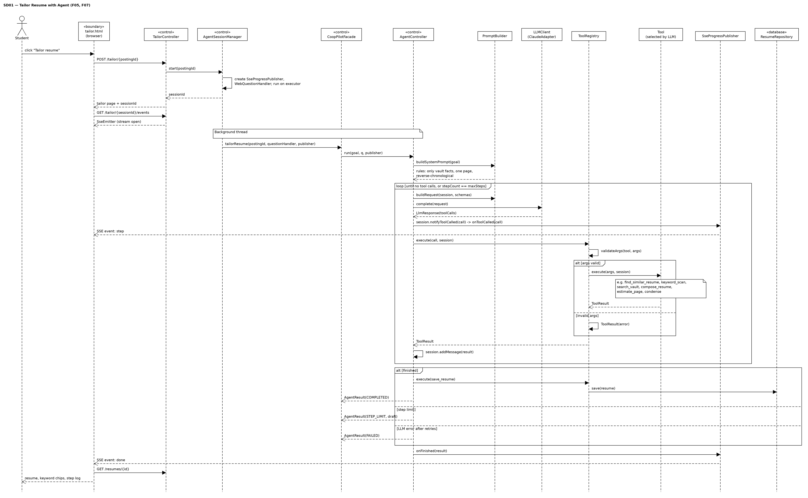

### SD02 — Clarifying Question and Vault Learning (F06)

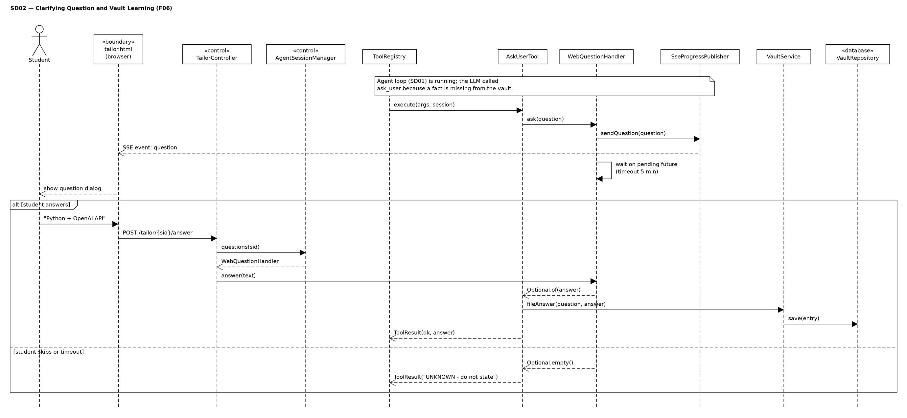

### SD03 — Import Posting, Fit Analysis and Keyword Coverage (F02, F03, F04)

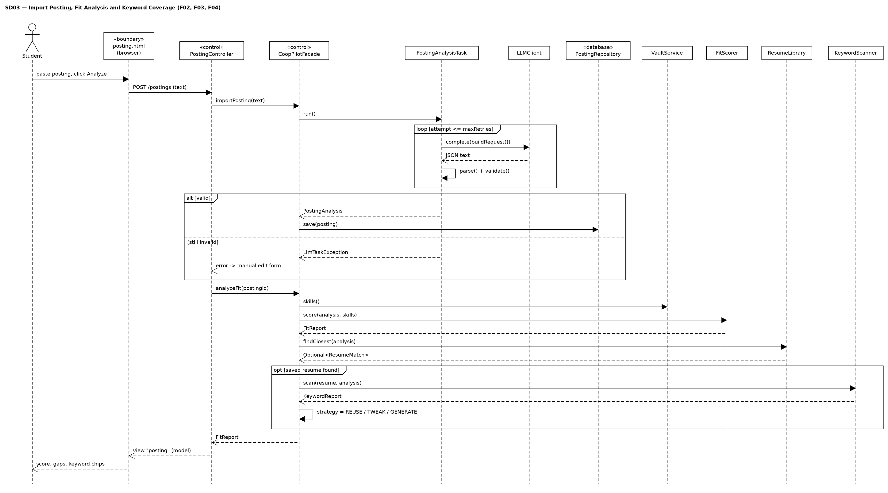

### SD04 — Natural-Language Revision with Undo (F08)

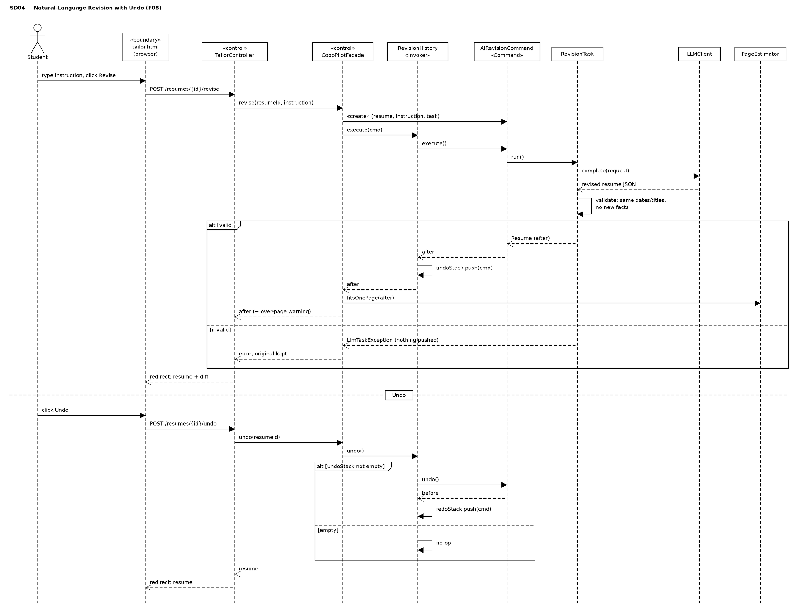

### SD05 — Draft Cover Letter (F09)

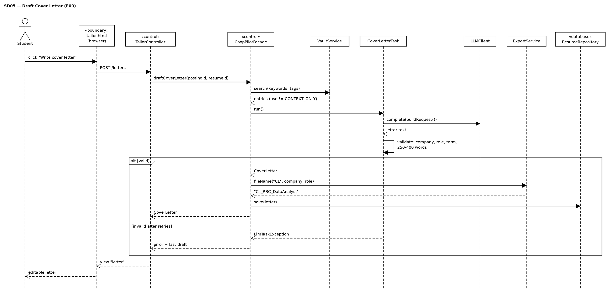

### SD06 — Reuse Saved Resume and Export (F10)

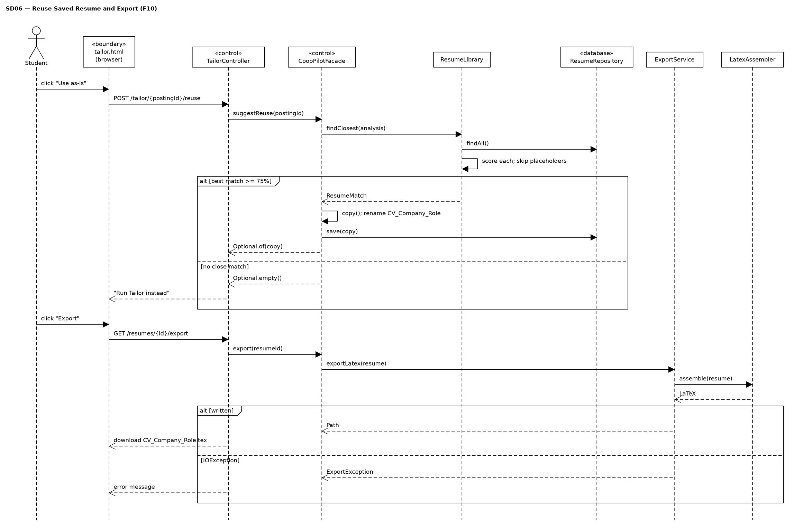

### SD07 — Update Application Status and Dashboard (F11, F12)

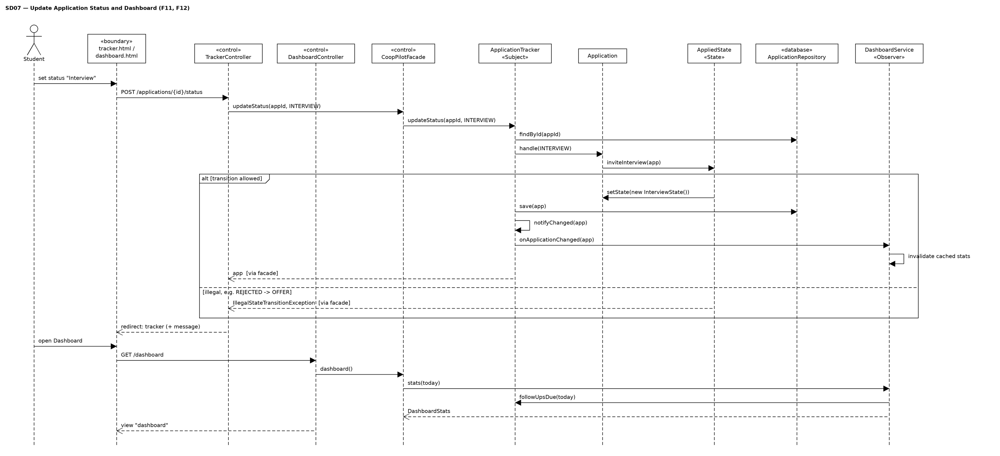

### SD08 — Import Resume into Vault (F01)

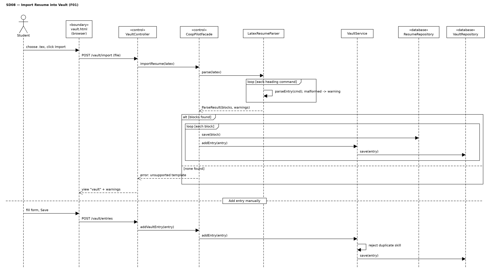

### SD09 — CLI Tailoring (all features through the CLI)

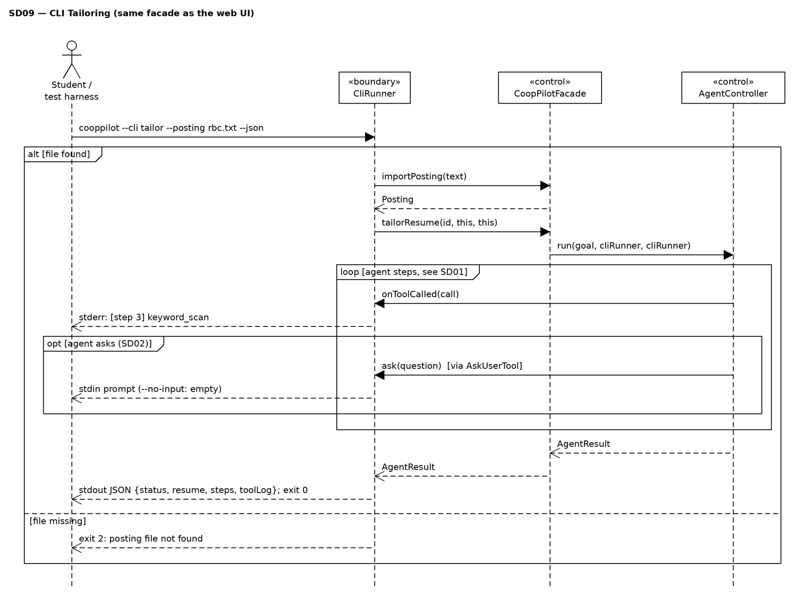

---

## 8. Feature-to-Design Traceability Table

| Feature | Description | Type | Related use case | Classes | Key methods | Sequence diagram | Design pattern(s) |
|---|---|---|---|---|---|---|---|
| F01 | Experience vault and resume import | D | UC01 | VaultController, CoopPilotFacade, LatexResumeParser, VaultService, VaultEntry, ResumeBlock, VaultRepository, ResumeRepository | `importResume()`, `parse()`, `parseEntry()`, `addEntry()`, `save()` | SD08 | Facade, Repository |
| F02 | Posting import and analysis | H | UC02 | PostingController, CoopPilotFacade, PostingAnalysisTask, LLMClient, ClaudeAdapter, Posting, PostingAnalysis, PostingRepository | `importPosting()`, `run()`, `buildRequest()`, `parse()`, `validate()`, `complete()` | SD03 | Template Method, Adapter, Facade |
| F03 | Fit analysis and skill gaps | H | UC03 | PostingController, CoopPilotFacade, FitScorer, VaultService, ResumeLibrary, FitReport, ResumeMatch | `analyzeFit()`, `score()`, `skills()`, `findClosest()` | SD03 | Facade |
| F04 | ATS keyword coverage | D | UC03 | KeywordScanner, KeywordReport, Keyword, KeywordScanTool | `scan()`, `coverage()` | SD03, SD01 | — (wrapped as a Tool) |
| F05 | Agentic resume tailoring | AI | UC04 | TailorController, AgentSessionManager, SseProgressPublisher, CoopPilotFacade, AgentController, AgentSession, PromptBuilder, LLMClient, ToolRegistry, Tool + 9 tools, LatexAssembler, ResumeRepository | `startTailoring()`, `start()`, `tailorResume()`, `run()`, `buildRequest()`, `complete()`, `execute()`, `validateArgs()`, `assemble()` | SD01, SD09 | Observer, Adapter, Facade |
| F06 | Clarifying questions and vault learning | H | UC06 | AskUserTool, QuestionHandler, WebQuestionHandler, SseProgressPublisher, TailorController, CliRunner, VaultService, VaultRepository | `ask()`, `sendQuestion()`, `answer()`, `fileAnswer()`, `save()` | SD02, SD09 | (interface polymorphism: web/CLI handlers) |
| F07 | One-page fitting | H | UC05 | PageEstimator, CondenseStrategy, RuleBasedCondense, LlmCondense, SmartCondenseTask, EstimatePageTool, CondenseTool | `estimate()`, `fitsOnePage()`, `condense()` | SD01 | Strategy, Template Method |
| F08 | Natural-language revision with undo | H | UC07 | TailorController, CoopPilotFacade, RevisionHistory, ResumeEditCommand, AiRevisionCommand, ReplaceBulletCommand, RemoveBlockCommand, RevisionTask | `revise()`, `execute()`, `undo()`, `redo()`, `run()` | SD04 | Command, Template Method |
| F09 | Cover letter drafting | AI | UC08 | TailorController, CoopPilotFacade, VaultService, CoverLetterTask, LLMClient, ExportService, CoverLetter | `draftCoverLetter()`, `search()`, `run()`, `validate()`, `fileName()` | SD05 | Template Method, Adapter |
| F10 | Resume library, reuse and export | D | UC09 | TailorController, CoopPilotFacade, ResumeLibrary, ResumeRepository, ExportService, LatexAssembler, ResumeMatch | `suggestReuse()`, `findClosest()`, `groupByFamily()`, `exportLatex()` | SD06 | Facade, Repository |
| F11 | Application tracking lifecycle | D | UC10 | TrackerController, CoopPilotFacade, ApplicationTracker, Application, ApplicationState (+7 states), ApplicationRepository | `updateStatus()`, `handle()`, `inviteInterview()`, `setState()` | SD07 | State, Observer |
| F12 | Progress dashboard and goals | D | UC11 | DashboardController, CoopPilotFacade, DashboardService, DashboardStats, Goals, ApplicationTracker | `onApplicationChanged()`, `stats()`, `followUpsDue()` | SD07 | Observer |

---

## 9. How Each Feature Is Realized

### F01 — Experience Vault and Resume Import
**Use case:** UC01 · **Sequence diagram:** SD08
**Classes:** `VaultController` + `vault.html` (collect the file/entry input), `CoopPilotFacade` (coordinates), `LatexResumeParser` (turns LaTeX into `ResumeBlock`s), `VaultService` (vault rules, e.g. duplicate skills), `VaultRepository` / `ResumeRepository` (storage).
**Execution:** the upload form posts to `VaultController.importResume(file)`, which calls `CoopPilotFacade.importResume(latex)`. The facade calls `LatexResumeParser.parse()`, which calls `parseEntry()` per heading and collects warnings. Each block is saved, and a matching `VaultEntry` is created through `VaultService.addEntry()`.

### F02 — Posting Import and Analysis
**Use case:** UC02 · **Sequence diagram:** SD03
**Classes:** `PostingController` + `posting.html`, `CoopPilotFacade`, `PostingAnalysisTask` (prompt + parse + validate), `LLMClient`/`ClaudeAdapter`, `Posting`, `PostingAnalysis`, `PostingRepository`.
**Execution:** `importPosting(text)` creates a `PostingAnalysisTask` and calls `run()`. The inherited template runs `buildRequest()` → `llm.complete()` → `parse()` → `validate()`, retrying on failure. The result is attached to a new `Posting` and saved.

### F03 — Fit Analysis and Skill Gaps
**Use case:** UC03 · **Sequence diagram:** SD03
**Classes:** `FitScorer` (deterministic score), `VaultService` (skills), `ResumeLibrary` (closest resume), `FitReport`.
**Execution:** `analyzeFit(id)` gets `VaultService.skills()`, calls `FitScorer.score(analysis, skills)` for matched/gaps/score, then `ResumeLibrary.findClosest()` and sets `strategy` from the match percentage.

### F04 — ATS Keyword Coverage
**Use case:** UC03 · **Sequence diagrams:** SD03, SD01
**Classes:** `KeywordScanner`, `KeywordReport`, `Keyword`; wrapped by `KeywordScanTool` for the agent.
**Execution:** `KeywordScanner.scan(resume, analysis)` strips LaTeX, then matches each `Keyword` and its aliases. Keywords not found are checked against the vault to separate "known but not worded" from "missing". The web UI calls it (through the facade) after every change; the agent calls it through the tool.

### F05 — Agentic Resume Tailoring
**Use case:** UC04 · **Sequence diagram:** SD01
**Classes:** `TailorController` + `tailor.html` (trigger), `AgentSessionManager` (runs the agent on a background thread), `SseProgressPublisher` (live log via `AgentEventListener`), `CoopPilotFacade`, `AgentController` (loop), `AgentSession` (messages, draft, tool log), `PromptBuilder` (system prompt with rules + tool schemas), `LLMClient`, `ToolRegistry` (argument validation + dispatch), the nine `Tool` implementations, and the services they wrap.
**Execution:** `TailorController.startTailoring()` asks `AgentSessionManager.start()` to run `CoopPilotFacade.tailorResume()` on a background thread, and the page opens an SSE stream (`events()`). `tailorResume()` builds an `AgentGoal` and calls `AgentController.run()`. Each step, `PromptBuilder.buildRequest()` packs the session and `ToolRegistry.schemas()`; `LLMClient.complete()` returns tool calls; `ToolRegistry.execute()` validates and runs each one, and the `ToolResult` is appended to the session. The session notifies its listeners at each call, and `SseProgressPublisher` forwards them to the browser. The loop ends when the LLM saves the resume and stops calling tools, or at `maxSteps`.

### F06 — Clarifying Questions and Vault Learning
**Use case:** UC06 · **Sequence diagram:** SD02
**Classes:** `AskUserTool`, `QuestionHandler` (implemented by `WebQuestionHandler` and `CliRunner`), `SseProgressPublisher`, `TailorController`, `VaultService`, `VaultRepository`.
**Execution:** when the LLM calls `ask_user`, `AskUserTool.execute()` calls `session.questionHandler.ask(question)`. On the web, `WebQuestionHandler` pushes the question over SSE and waits (up to 5 minutes) until the browser POSTs the answer to `TailorController.answer()`. An answer goes to `VaultService.fileAnswer()`, which updates the matching entry or creates one, and back to the agent as a `ToolResult`. A skip returns `UNKNOWN`.

### F07 — One-Page Fitting
**Use case:** UC05 · **Sequence diagram:** SD01
**Classes:** `PageEstimator`, `CondenseStrategy`, `RuleBasedCondense`, `LlmCondense` (uses `SmartCondenseTask`), `EstimatePageTool`, `CondenseTool`.
**Execution:** `PageEstimator.estimate()` sums per-block line costs. If it is over one page, `CondenseTool` (agent) or the facade (button) calls `strategy.condense(resume, analysis, estimator)`. `RuleBasedCondense` applies its ordered steps until `fitsOnePage()` is true.

### F08 — Natural-Language Revision with Undo
**Use case:** UC07 · **Sequence diagram:** SD04
**Classes:** `RevisionHistory` (invoker), `AiRevisionCommand` / `ReplaceBulletCommand` / `RemoveBlockCommand`, `RevisionTask`, `PageEstimator`.
**Execution:** `revise(id, instruction)` creates an `AiRevisionCommand` and passes it to `RevisionHistory.execute()`. The command runs `RevisionTask.run()`, stores before/after, and is pushed onto the undo stack. `undo()` pops it and calls `cmd.undo()`, which restores the `before` snapshot.

### F09 — Cover Letter Drafting
**Use case:** UC08 · **Sequence diagram:** SD05
**Classes:** `VaultService`, `CoverLetterTask`, `LLMClient`, `ExportService`, `CoverLetter`.
**Execution:** `draftCoverLetter()` collects relevant vault entries (excluding `CONTEXT_ONLY`), runs `CoverLetterTask.run()` (template method with letter-specific validation), names it with `ExportService.fileName("CL", ...)` and saves it.

### F10 — Resume Library, Reuse and Export
**Use case:** UC09 · **Sequence diagram:** SD06
**Classes:** `ResumeLibrary`, `ResumeRepository`, `ExportService`, `LatexAssembler`.
**Execution:** `suggestReuse()` calls `ResumeLibrary.findClosest()`, which scores all saved resumes (skipping ones with placeholders). At ≥ 75% the facade saves a renamed copy. `export()` calls `ExportService.exportLatex()`, which renders through `LatexAssembler.assemble()` and writes the file.

### F11 — Application Tracking Lifecycle
**Use case:** UC10 · **Sequence diagram:** SD07
**Classes:** `TrackerController` + `tracker.html`, `ApplicationTracker` (subject), `Application` (context), `ApplicationState` + concrete states, `ApplicationRepository`.
**Execution:** `updateStatus(id, event)` loads the application and calls `handle(event)`, which forwards to the current state's method (e.g. `inviteInterview()`). Allowed transitions call `setState(...)`; others throw. The tracker saves the application and calls `notifyChanged()`.

### F12 — Progress Dashboard and Goals
**Use case:** UC11 · **Sequence diagram:** SD07
**Classes:** `DashboardController` + `dashboard.html`, `DashboardService` (`ApplicationListener`), `DashboardStats`, `Goals`, `ApplicationTracker`.
**Execution:** whenever an application changes, `ApplicationTracker` notifies `DashboardService.onApplicationChanged()`, which invalidates its cached stats. When the student opens the page, `DashboardController.dashboard()` calls `CoopPilotFacade.dashboard()` → `DashboardService.stats(today)`, which recomputes counts, the streak and `followUpsDue()` if needed and returns `DashboardStats` for the Thymeleaf view.

---

## 10. Key Design Decisions

1. **The LLM plans; deterministic code enforces.** Ordering, no-bold rules, file naming and page budget live in `LatexAssembler`, `PageEstimator` and `ExportService`, not in the prompt. Even if the LLM misbehaves, the output cannot break these rules.
2. **Tools are the only way the LLM can act.** `ToolRegistry.validateArgs()` rejects malformed calls before anything runs. This makes behaviours like "never runs a tool with invalid arguments" checkable in Stage 3.
3. **Ask, don't guess.** A dedicated `ask_user` tool plus vault learning turns missing facts into memory, instead of placeholders or hallucinations.
4. **One facade, two UIs.** The web controllers and CLI are thin. The CLI's `--json` output gives Stage 3 a stable way to drive the agent from KUMA (Python) and capture the tool log for behavioural checks.
5. **The LLM is behind an interface.** `MockLlmClient` makes deterministic components and the agent loop unit-testable without network calls; the Adapter lets the model be swapped if cost or quality requires it.
6. **Bounded agent loop.** `maxSteps` (default 15) and retry limits keep cost predictable and give a clear `STEP_LIMIT` outcome instead of an endless loop.
7. **Server-rendered web UI.** Spring Boot + Thymeleaf keeps almost all code in Java: pages are HTML templates filled by Java controllers. The agent runs on a background thread so the request never blocks, and SSE pushes steps and questions to the page with a few lines of JavaScript. Spring's dependency injection wires the concrete `LLMClient`, tools and repositories in `AppConfig`, which keeps the rest of the code depending only on interfaces.

### AI assistance in Stage 1

*(To be completed by the author.)* I used Claude (Cowork) to help draft and format this report and generate the UMLet diagram files from my design decisions and requirements; I reviewed and edited the result. This interaction will be included in the Stage 2 AI–human collaboration log.
