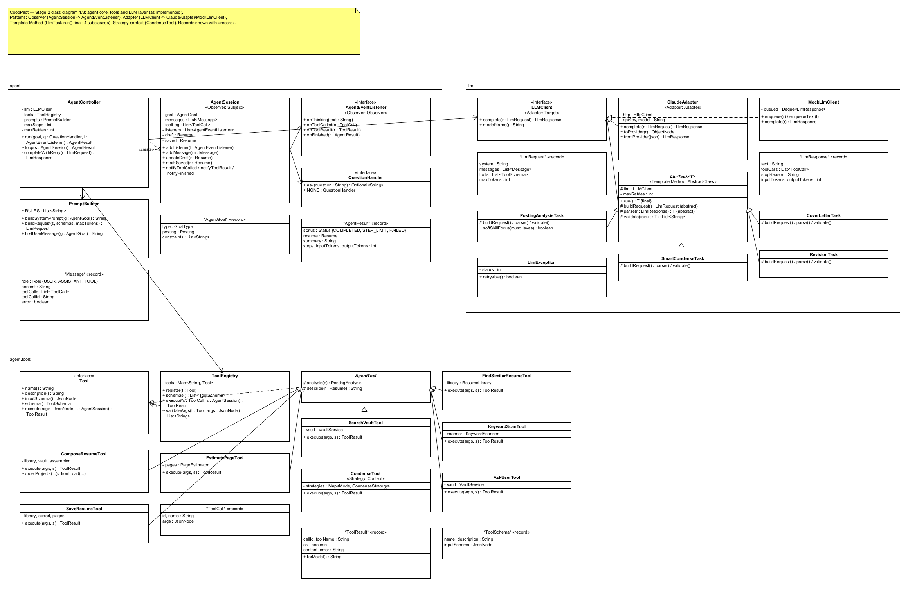
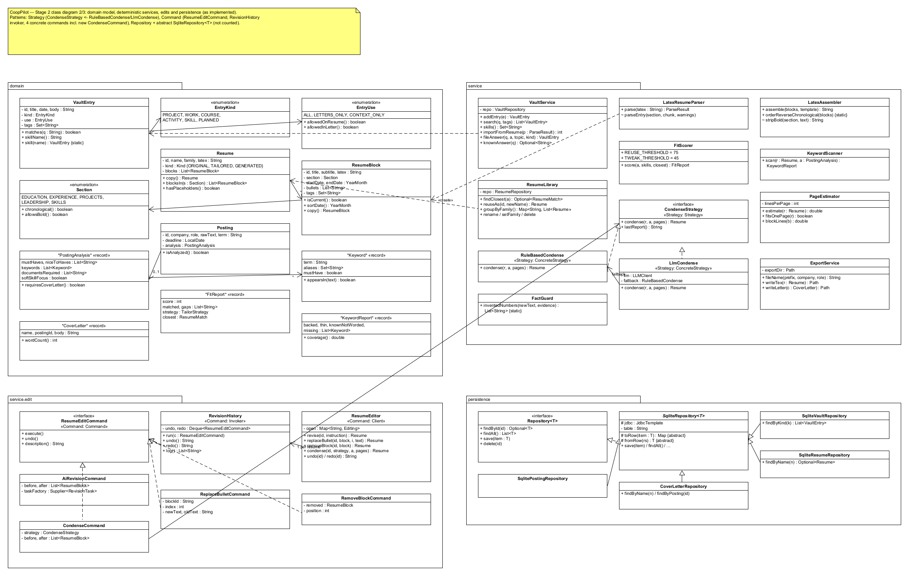
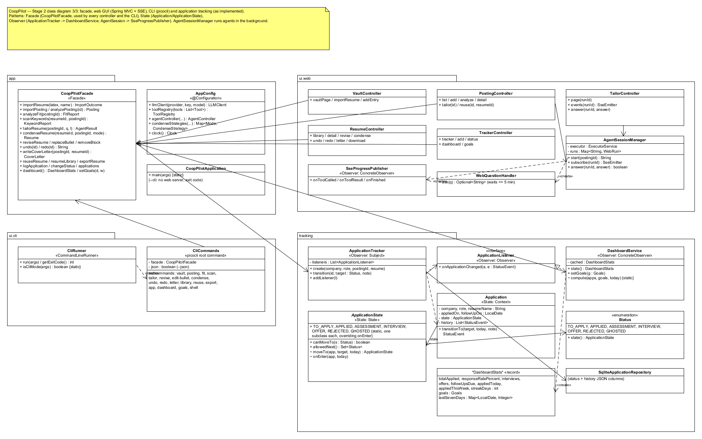

# 1. Project overview and implementation status

**CoopPilot** is an AI agent that helps a co-op student apply for jobs. The student keeps their real experience in an *experience vault* (imported from their LaTeX resume and extended by hand). For each job posting, an LLM extracts the requirements and keywords, deterministic code scores the student's fit, and a tool-using agent builds a **one-page, tailored LaTeX resume** from the student's own material, asking the student when a fact is missing instead of guessing. The student can then revise the resume in plain English (with undo/redo), draft a cover letter, export the files for Overleaf, and track every application through its lifecycle on a progress dashboard.

**Users.** University co-op students (the author first) who apply to many postings each term and need each resume to fit the posting, stay truthful, and fit on one page.

**AI / LLM integration.** Anthropic Claude (default model `claude-haiku-4-5`) through the Messages API with native tool use, behind the `LLMClient` interface. The LLM is used in two ways:

* **Agent (F05–F07):** a reason–act–observe loop (`AgentController`) in which the model chooses among 9 tools (find similar resume, search vault, keyword scan, compose, estimate page, condense, ask user, save). This covers the required agent behaviours: *planning and multi-step execution* (the loop, up to 15 steps), *tool use* (validated by `ToolRegistry`), *retrieval* (vault and resume library search), *memory* (answers are filed in the vault and never asked again), and *decision making* (reuse vs. rewrite, what to cut to fit one page).
* **Single-shot tasks (F02, F08, F09, smart F07):** posting analysis, natural-language revision, cover letters and smart condensing, each through the `LlmTask<T>` template, which validates the reply and retries with the problems listed.

Deterministic Java code enforces every rule the LLM could break: only facts from the vault (new numbers in rewritten text are rejected by `FactGuard`), reverse-chronological Experience, no bold words in Education/Skills, one page maximum, and `CV_Company_Role` / `CL_Company_Role` naming.

**Current working functionality.** All 12 Stage 1 features are implemented and reachable from **both** interfaces:

* **Web GUI** (Spring Boot 3 + Thymeleaf, `mvn spring-boot:run`, http://localhost:8080): Vault, Postings, live Tailoring page (agent steps streamed over Server-Sent Events, questions answered in the page), Resumes (revise/undo/redo, one-page meter and condense, cover letter, `.tex` download), Tracker, Dashboard.
* **CLI** (picocli, `java -jar target/cooppilot-0.1.0.jar --cli <command>`): a command for every feature, `--json` output for scripting (used by the Stage 3 KUMA tests), and an interactive `shell` in which undo/redo history persists between commands.
* **Storage:** SQLite (`cooppilot.db`, git-ignored). **Build:** Maven, Java 21. **Tests:** 86 automated tests (JUnit 5, Spring Boot Test, MockMvc) pass.

**Limitations and incomplete functionality (honest list).**

1. **Real-LLM behaviour is verified by one manual run, not by automated tests.** Automated tests drive the agent with a scripted `MockLlmClient`; the quality of the real model's tool choices was checked manually (Section 6). Systematic agent evaluation is Stage 3 (KUMA).
2. **Undo/redo history lives in memory**: it is lost when the application restarts, and in the CLI it only spans one process (hence the `shell` command).
3. **The page estimate is a heuristic** (line-cost model), not a compiled PDF; LaTeX is compiled by the student in Overleaf.
4. **Single user, no authentication**; the app is meant to run locally.
5. Not implemented from the Stage 1 design: the `OpenAiCompatibleAdapter` (only Claude and the mock exist), a "What changed" diff view for revisions (a revision log is shown instead), an editable cover-letter text area (letters are viewed and downloaded), manual entry of analysis fields when posting analysis fails, and deadline extraction from postings. Each is listed in Section 4 with its reason.
6. Without an API key the app runs with the mock LLM: deterministic features work fully, LLM features return a fixed "no key" reply.

# 2. Feature-to-implementation mapping

Every Stage 1 feature (F01–F12) is accounted for below. No feature was removed or replaced; several were modified (details in Section 4). There are no new features beyond F01–F12; the CLI `shell` and `--json` mode are interface additions, not features. Type: **D** deterministic, **AI** LLM-based, **H** hybrid. Package prefix `ca.yorku.cooppilot` is omitted. Video links are in Section 7.

## F01 — Experience Vault and Resume Import (D)

| Field | Entry |
|---|---|
| Stage 1 reference | F01, UC01, SD08 |
| Status | Implemented (minor modification: duplicates are merged, see C-F01) |
| Classes / files | `service.LatexResumeParser` (splits a Jake's-template `.tex` into blocks), `service.LatexText` (brace-balanced argument reader, LaTeX→text, date ranges), `service.VaultService` (vault rules: dedupe, search, skills, import), `domain.VaultEntry`/`EntryKind`/`EntryUse`, `domain.ResumeBlock`/`Resume`/`Section`, `persistence.SqliteVaultRepository`, `persistence.SqliteResumeRepository`, `app.CoopPilotFacade`, `ui.web.VaultController` + `vault.html`, `ui.cli.CliCommands.VaultCmd` |
| Key methods | `LatexResumeParser.parse(latex)`, `VaultService.importFromResume(parse)`, `VaultService.addEntry(e)`, `VaultService.search(q, tags)`, `CoopPilotFacade.importResume(latex, name)` |
| Design patterns | Facade; Repository (not counted) |
| Video | V01 |

**Collaboration.** The Vault page uploads the `.tex` file (CLI: `vault import FILE`) → `VaultController` calls `CoopPilotFacade.importResume` → `LatexResumeParser` finds each `\section`, reads `\resumeSubheading` (detecting the education vs. experience argument order), `\resumeProjectHeading` (tech stack → tags), `\resumeItem` bullets and skill lines, and returns blocks plus warnings → the facade saves an `ORIGINAL` resume and `VaultService` creates one vault entry per experience and one skill entry per skill, merging duplicates → the page shows counts and warnings. Re-importing the same resume adds nothing.

## F02 — Job Posting Import and Analysis (H)

| Field | Entry |
|---|---|
| Stage 1 reference | F02, UC02, SD03 |
| Status | Modified (no manual field entry on failure; deadline not extracted; see C-F02) |
| Classes / files | `llm.PostingAnalysisTask` (prompt, JSON parsing, validation, soft-skill rule), `llm.LlmTask` (retry template), `llm.JsonReply` (extracts JSON from chatty replies), `domain.Posting`/`PostingAnalysis`/`Keyword`, `persistence.SqlitePostingRepository`, `CoopPilotFacade`, `ui.web.PostingController` + `postings.html`/`posting.html`, `CliCommands.PostingCmd` |
| Key methods | `CoopPilotFacade.importPosting(text, company, role)`, `CoopPilotFacade.analyzePosting(id)`, `LlmTask.run()`, `PostingAnalysisTask.parse/validate`, `PostingAnalysisTask.softSkillFocus(mustHaves)` |
| Design patterns | Template Method, Adapter, Facade |
| Video | V02 |

**Collaboration.** The student pastes a posting (CLI: `posting add FILE --analyze`) → the facade saves it → `PostingAnalysisTask.run()` (template) builds a strict-JSON prompt, calls `LLMClient`, parses must-haves, nice-to-haves, keywords with aliases and required documents, and validates (keywords non-empty, requirements present); invalid replies are retried with the problems listed. The **soft-skill focus** flag is then recomputed deterministically (2+ or 40%+ of must-haves are soft skills). Blank company/role/term are filled from the analysis.

## F03 — Fit Analysis and Skill-Gap Detection (H)

| Field | Entry |
|---|---|
| Stage 1 reference | F03, UC03, SD03 |
| Status | Implemented (TWEAK threshold added, see C-F03) |
| Classes / files | `service.FitScorer` (weighted score, gaps, strategy thresholds), `service.ResumeLibrary.findClosest` (closest saved resume), `domain.FitReport`/`ResumeMatch`/`TailorStrategy`, `CoopPilotFacade.analyzeFit`, `posting.html`, `CliCommands.FitCmd` |
| Key methods | `FitScorer.score(analysis, skills, closest)`, `ResumeLibrary.findClosest(analysis)`, `FitScorer.strategy(closest)` |
| Design patterns | Facade |
| Video | V03 |

**Collaboration.** After analysis, the posting page (CLI: `fit POSTING_ID`) calls `CoopPilotFacade.analyzeFit` → `FitScorer` matches each keyword (must-haves weigh 2) against the vault's skills and lists the gaps, must-haves first → `ResumeLibrary.findClosest` scores every saved resume that has no `[placeholders]` → the strategy is **REUSE** at ≥ 75% match, **TWEAK** at ≥ 45%, else **GENERATE**. The LLM's part is the analysis from F02; the scoring is deterministic.

## F04 — ATS Keyword Coverage Scan (D)

| Field | Entry |
|---|---|
| Stage 1 reference | F04, UC03, SD03 |
| Status | Implemented |
| Classes / files | `service.KeywordScanner`, `service.ResumeText` (plain-text views of a resume; "evidence" text excludes the skills line), `domain.Keyword.appearsIn` (word-boundary matching: Java ≠ JavaScript, C++ handled), `domain.KeywordReport`, `agent.tools.KeywordScanTool`, `posting.html` chips, `CliCommands.ScanCmd` |
| Key methods | `KeywordScanner.scan(resume, analysis)`, `Keyword.appearsIn(text)`, `KeywordReport.coverage()` |
| Design patterns | N/A (used as an agent tool) |
| Video | V04 |

**Collaboration.** For a chosen resume, `KeywordScanner` strips LaTeX, then classifies each posting keyword as **backed** (in experience/project text), **thin** (only in the skills line), **known but not worded** (the vault supports it) or **missing**. The page shows coloured chips; the agent calls the same scanner through `keyword_scan`.

## F05 — Agentic Resume Tailoring (AI)

| Field | Entry |
|---|---|
| Stage 1 reference | F05, UC04, SD01, SD09 |
| Status | Implemented (direct HTTP adapter instead of the SDK; richer `Message`; see C01, C02) |
| Classes / files | `agent.AgentController` (loop, step limit, LLM retry), `agent.AgentSession` (conversation, draft, listeners), `agent.PromptBuilder` (goal + hard rules), `agent.tools.ToolRegistry` (argument validation), tools `FindSimilarResumeTool`, `SearchVaultTool`, `KeywordScanTool`, `ComposeResumeTool`, `EstimatePageTool`, `CondenseTool`, `AskUserTool`, `SaveResumeTool`; `service.LatexAssembler`, `service.FactGuard`, `service.ExportService.fileName`; `llm.ClaudeAdapter`; `ui.web.AgentSessionManager`, `SseProgressPublisher`, `TailorController` + `tailor.html`; `CliCommands.TailorCmd` |
| Key methods | `CoopPilotFacade.tailorResume(postingId, q, listener)`, `AgentController.run/loop/completeWithRetry`, `ToolRegistry.execute/validateArgs`, `ComposeResumeTool.execute`, `LatexAssembler.assemble`, `SaveResumeTool.execute` |
| Design patterns | Observer, Adapter, Facade (+ Strategy through `CondenseTool`) |
| Video | V05 |

**Collaboration.** "Tailor with the agent" (CLI: `tailor POSTING_ID`) → `AgentSessionManager` starts the run on a background thread → `AgentController` sends the system prompt (goal + rules) and tool schemas to Claude → each tool call the model makes is validated by `ToolRegistry` (unknown tools, missing or mistyped arguments and tool exceptions go back to the model as errors) and executed; results return to the conversation → typical plan: `find_similar_resume` → `search_vault` → `compose_resume` (keep/reorder blocks, front-load skills, reword bullets; rewrites with invented numbers are rejected) → `keyword_scan` → `estimate_page` → `condense` if needed → `save_resume` (refused over one page; named `CV_Company_Role`). `SseProgressPublisher` (observer) streams every step to the browser. The run ends when the model stops calling tools (`COMPLETED` if saved), at 15 steps (`STEP_LIMIT`), or on a non-retryable LLM error (`FAILED`); 429/5xx errors are retried with backoff.

## F06 — Clarifying Questions and Vault Learning (H)

| Field | Entry |
|---|---|
| Stage 1 reference | F06, UC06, SD02 |
| Status | Modified (answers filed as fact lines; repeats answered from the vault; see C-F06) |
| Classes / files | `agent.tools.AskUserTool`, `agent.QuestionHandler` (interface), `ui.web.WebQuestionHandler` (waits ≤ 5 min for the browser's answer), CLI stdin handler in `CliCommands.TailorCmd`, `service.VaultService.fileAnswer/knownAnswer` |
| Key methods | `AskUserTool.execute`, `QuestionHandler.ask(question)`, `AgentSessionManager.answer(runId, answer)`, `VaultService.fileAnswer(q, a, topic, kind)`, `VaultService.knownAnswer(q)` |
| Design patterns | Interface polymorphism (`QuestionHandler`) |
| Video | V06 |

**Collaboration.** When a non-numeric fact is missing, the model calls `ask_user` → `AskUserTool` first checks the vault for an earlier answer to the same question → otherwise `QuestionHandler.ask` shows the question (web: an SSE `question` event and an answer box; CLI: a `?` prompt) → the answer is added to the vault entry it is about (or a new entry) → the tool result goes back to the model. An empty answer or a timeout tells the model not to guess.

## F07 — One-Page Fitting (Estimate and Condense) (H)

| Field | Entry |
|---|---|
| Stage 1 reference | F07, UC05, SD01 |
| Status | Implemented (+ undoable `CondenseCommand`; smart mode falls back to rules; see C03) |
| Classes / files | `service.PageEstimator`, `service.CondenseStrategy` (interface), `service.RuleBasedCondense`, `service.LlmCondense` + `llm.SmartCondenseTask`, `service.edit.CondenseCommand`, `agent.tools.EstimatePageTool`/`CondenseTool`, `AppConfig.condenseStrategies`, `resume.html` (page meter, Quick/Smart condense), `CliCommands.CondenseCmd` |
| Key methods | `PageEstimator.estimate(resume)`, `CondenseStrategy.condense(resume, analysis, pages)`, `CoopPilotFacade.condenseResume(resumeId, postingId, mode)`, `ResumeEditor.condense` |
| Design patterns | Strategy, Command, Template Method (smart) |
| Video | V07 |

**Collaboration.** `PageEstimator` sums each block's heading and wrapped-bullet lines into a fraction of a page (shown as a meter, red when over 100%). **Quick condense** (`RuleBasedCondense`, free) removes the least relevant content in a fixed order: irrelevant projects (keeping 2) → projects, then jobs, to 2 bullets → weakest extra project → projects, then jobs, to 1 bullet. Jobs give way last and one project always stays. **Smart condense** (`LlmCondense`) asks the model what to cut or shorten (validated: no unknown bullets, no new numbers) and finishes with the rules if still over. From the GUI/CLI the condense runs as a `CondenseCommand`, so it can be undone; inside the agent it runs through `CondenseTool`.

## F08 — Natural-Language Revision with Version History (H)

| Field | Entry |
|---|---|
| Stage 1 reference | F08, UC07, SD04 |
| Status | Modified (revision log instead of a diff view; see C-F08) |
| Classes / files | `service.edit.ResumeEditor` (one `RevisionHistory` per resume; reassembles and saves after each step), `RevisionHistory` (invoker), `ResumeEditCommand` + `AiRevisionCommand`, `ReplaceBulletCommand`, `RemoveBlockCommand`, `CondenseCommand`; `llm.RevisionTask`; `service.FactGuard`; `resume.html`; `CliCommands.ReviseCmd/EditBulletCmd/UndoCmd/RedoCmd` |
| Key methods | `CoopPilotFacade.reviseResume/replaceBullet/removeBlock/undo/redo/revisionLog`, `RevisionHistory.run/undo/redo`, `AiRevisionCommand.execute/undo` |
| Design patterns | Command, Template Method |
| Video | V08 |

**Collaboration.** The student types a request (CLI: `revise ID "..."`) → `ResumeEditor` creates an `AiRevisionCommand` and runs it through the resume's `RevisionHistory` → the command snapshots the blocks and runs `RevisionTask` (bullet rewrites/removals as JSON; validation rejects unknown bullets and numbers not in the vault or resume) → the LaTeX is reassembled and saved. Undo restores the snapshot; redo reapplies the stored result **without calling the LLM again**. A new edit clears the redo branch.

## F09 — Cover Letter Drafting (AI)

| Field | Entry |
|---|---|
| Stage 1 reference | F09, UC08, SD05 |
| Status | Modified (180–450 word validation window; view + download instead of an editable text area; see C-F09) |
| Classes / files | `llm.CoverLetterTask`, `persistence.CoverLetterRepository`, `domain.CoverLetter`, `CoopPilotFacade.writeCoverLetter`, `ui.web.ResumeController` + `letter.html`, `CliCommands.LetterCmd` |
| Key methods | `CoopPilotFacade.writeCoverLetter(postingId, resumeId)`, `CoverLetterTask.buildRequest/parse/validate` |
| Design patterns | Template Method |
| Video | V09 |

**Collaboration.** From a resume page (CLI: `letter POSTING_ID RESUME_ID`) → the facade collects only vault entries allowed in letters (`ALL`, `LETTERS_ONLY`; never `CONTEXT_ONLY`) → `CoverLetterTask` asks for a 250–350-word plain-text letter that states the posting's term and connects 2–3 real experiences to the must-haves → validation rejects bad length, letters that don't name the company, `[placeholders]` and invented numbers, with retries → saved as `CL_Company_Role`, viewable and downloadable as `.txt`.

## F10 — Resume Library, Reuse and Export (D)

| Field | Entry |
|---|---|
| Stage 1 reference | F10, UC09, SD06 |
| Status | Modified (match formula; see C-F10) |
| Classes / files | `service.ResumeLibrary` (closest match, `reuseAs`, grouping, rename, family, delete), `service.ExportService` (naming, `.tex`/`.txt` export with sanitized names), `resumes.html`/`resume.html`/`posting.html` ("Use as-is", download), `CliCommands.LibraryCmd/ReuseCmd/ExportCmd` |
| Key methods | `CoopPilotFacade.reuseResume(postingId, resumeId)`, `ResumeLibrary.reuseAs`, `ResumeLibrary.groupByFamily`, `ExportService.fileName/writeTex/writeLetter` |
| Design patterns | Facade |
| Video | V10 |

**Collaboration.** When F03 recommends REUSE, "Use as-is" copies the saved resume unchanged as `CV_Company_Role` (the original is kept; resumes with placeholders are refused; repeating replaces the copy). The library groups resumes by role family; any resume downloads as `.tex` (GUI) or is written to `exports/` (CLI `export`), with names sanitized so they cannot leave that folder.

## F11 — Application Tracking with Status Lifecycle (D)

| Field | Entry |
|---|---|
| Stage 1 reference | F11, UC10, SD07 |
| Status | Modified (state objects as constants; exception type; see C-State) |
| Classes / files | `tracking.Application` (context), `tracking.ApplicationState` (state; seven concrete states), `tracking.Status`, `tracking.StatusEvent`, `tracking.ApplicationTracker` (subject), `tracking.SqliteApplicationRepository`, `ui.web.TrackerController` + `tracker.html`, `CliCommands.AppCmd` |
| Key methods | `CoopPilotFacade.logApplication/changeStatus`, `ApplicationTracker.transition(id, target, note)`, `Application.transitionTo`, `ApplicationState.moveTo/onEnter/allowedNext` |
| Design patterns | State, Observer |
| Video | V11 |

**Collaboration.** An application starts in **To apply** → moving it (GUI dropdown shows only legal next states; CLI `app status ID STATUS`) calls `ApplicationTracker.transition` → `Application` delegates to its current state, which refuses illegal moves (e.g. Rejected → Offer) and runs entry actions (**Applied** stamps the date and a +10-day follow-up; final states clear it; **Ghosted** can still be revived by a late reply) → the history event is saved and listeners are notified.

## F12 — Progress Dashboard and Goals (D)

| Field | Entry |
|---|---|
| Stage 1 reference | F12, UC11, SD07 |
| Status | Implemented (weekly chart = last 7 days) |
| Classes / files | `tracking.DashboardService` (observer with cached stats), `tracking.DashboardStats`, `tracking.Goals`, `settings` table, `ui.web.TrackerController.dashboard` + `dashboard.html`, `CliCommands.DashboardCmd/GoalsCmd` |
| Key methods | `DashboardService.stats()`, `DashboardService.compute(apps, goals, today)`, `DashboardService.streak(...)`, `CoopPilotFacade.dashboard/setGoals` |
| Design patterns | Observer |
| Video | V12 |

**Collaboration.** `DashboardService` registers with `ApplicationTracker` and drops its cached statistics whenever an application changes (or the goals change); `stats()` recomputes only then (and when the date changes): today and this week vs. goals (with "Goal met"), total applied, response rate, interviews, offers, follow-ups due, daily-goal streak and a last-7-days bar chart. Goals are stored in SQLite.

# 3. Implemented design patterns

Seven distinct patterns are implemented, matching the seven planned in Stage 1. MVC, Repository and dependency injection are also used but are not counted.

## 3.1 Strategy — interchangeable condense algorithms

* **Problem.** A resume can be fitted to one page cheaply with fixed rules or more cleverly with the LLM. The agent, the GUI buttons and the CLI must all trigger "condense" without knowing which algorithm runs.
* **Roles.** Strategy: `service.CondenseStrategy`. Concrete strategies: `service.RuleBasedCondense`, `service.LlmCondense`. Contexts: `agent.tools.CondenseTool` (agent) and `service.edit.CondenseCommand` (GUI/CLI). The strategies are registered by mode in `AppConfig.condenseStrategies()` (`Map<Mode, CondenseStrategy>`).
* **Files / methods.** `CondenseStrategy.condense(resume, analysis, pages)`, `lastReport()`; `CondenseTool.execute` and `CondenseCommand.execute` select by `Mode` and never branch on the algorithm.
* **Why useful.** Same signature, different cost and behaviour, chosen at run time (the agent's `mode` argument or the button pressed). `LlmCondense` even reuses `RuleBasedCondense` as its fallback. Adding a third algorithm means one class and one map entry.
* **Stage 1.** Matches. Change: the GUI/CLI context is `CondenseCommand` instead of the facade, so condensing is undoable (C03).

## 3.2 Command — undoable resume edits

* **Problem.** AI revisions, manual bullet edits, block removals and condensing all change a resume; the student must be able to undo and redo any of them in order, and an AI revision (expensive, non-repeatable) must be reversible exactly.
* **Roles.** Command: `service.edit.ResumeEditCommand`. Concrete commands: `AiRevisionCommand`, `ReplaceBulletCommand`, `RemoveBlockCommand`, `CondenseCommand`. Invoker: `RevisionHistory` (undo/redo stacks). Receiver: `domain.Resume`. Client: `ResumeEditor` (creates commands; one history per resume).
* **Files / methods.** `RevisionHistory.run/undo/redo/log`; each command's `execute()` stores what `undo()` needs (old text, removed block and position, or a before/after snapshot).
* **Why useful.** The history treats every edit uniformly; `AiRevisionCommand` calls the LLM only on the first `execute()` and redo reapplies the stored result.
* **Stage 1.** Matches, with one added concrete command (`CondenseCommand`) and the client moved from the facade to `ResumeEditor` (C-Command).

## 3.3 Adapter — provider-independent LLM access

* **Problem.** The agent and the LLM tasks need one request/response format with tool calls, independent of any provider's wire format, and must be testable without the network.
* **Roles.** Target: `llm.LLMClient`. Adapter: `llm.ClaudeAdapter` (translates `LlmRequest`/`LlmResponse`/`ToolCall`/`Message` to and from the Anthropic Messages API JSON: `tool_use`/`tool_result` blocks, merged consecutive tool results, usage). Second implementation: `llm.MockLlmClient`. Clients: `AgentController`, `LlmTask` subclasses, `LlmCondense`.
* **Files / methods.** `ClaudeAdapter.complete`, `toProvider`, `fromProvider`; provider chosen in `AppConfig.llmClient` from `cooppilot.llm.provider`.
* **Why useful.** No provider type appears outside the adapter; switching models or providers touches one class; every agent test runs on the mock.
* **Stage 1.** Partly different: the adaptee is the HTTP API directly (not the Java SDK), and `OpenAiCompatibleAdapter` was not built (C01, C-Adapter).

## 3.4 Observer — live agent progress and dashboard updates

* **Problem.** (a) The browser and the CLI show each agent step live, but the agent core must not depend on either UI. (b) Dashboard statistics must stay correct whenever any application changes, without recomputing on every page view.
* **Roles.** (a) Subject `agent.AgentSession`; observer interface `agent.AgentEventListener`; concrete observers `ui.web.SseProgressPublisher` (SSE events to the browser) and the CLI's printer in `CliCommands.TailorCmd`. (b) Subject `tracking.ApplicationTracker`; observer interface `tracking.ApplicationListener`; concrete observer `tracking.DashboardService` (invalidates its cache).
* **Files / methods.** `AgentSession.addListener`, `notifyToolCalled/notifyToolResult/notifyFinished`; `ApplicationTracker.addListener`, `transition` → `onApplicationChanged`.
* **Why useful.** One-to-many notification with no compile-time dependency from the core on any UI; the dashboard is cheap to read.
* **Stage 1.** Matches; the CLI observer is an anonymous listener inside `TailorCmd` rather than `CliRunner` itself (C-Observer).

## 3.5 State — application lifecycle

* **Problem.** What an application can do next depends on its status, and entering a status has side effects (Applied schedules a follow-up).
* **Roles.** Context: `tracking.Application`. State: `tracking.ApplicationState` (abstract). Concrete states: the seven constants `TO_APPLY`, `APPLIED`, `ASSESSMENT`, `INTERVIEW`, `OFFER`, `REJECTED`, `GHOSTED`, each an anonymous subclass that defines its legal next statuses and overrides `onEnter` where needed. `tracking.Status` is the stored name and maps back to its state.
* **Files / methods.** `Application.transitionTo(target, today, note)` delegates to `ApplicationState.moveTo`, which checks `canMoveTo` and calls the new state's `onEnter`.
* **Why useful.** No status `switch` anywhere; the GUI menu is built from `allowedNext()`; adding a status touches one place.
* **Stage 1.** Same pattern; different form (stateless shared constants instead of seven top-level classes, `IllegalStateException` instead of a custom exception, transitions by target status instead of events; C-State).

## 3.6 Facade — one entry point for both UIs

* **Problem.** A user action such as "tailor a resume" involves the agent, vault, library, repositories, editor and tracker, and two UIs need identical capabilities.
* **Roles.** Facade: `app.CoopPilotFacade`. Subsystems: `VaultService`, `LatexResumeParser`, `ResumeLibrary`, `FitScorer`, `KeywordScanner`, `AgentController`, `ResumeEditor`, `ExportService`, `ApplicationTracker`, `DashboardService`, repositories. Clients: `VaultController`, `PostingController`, `ResumeController`, `TrackerController`, `AgentSessionManager`, `CliCommands`.
* **Why useful.** Controllers and CLI commands are thin and call only the facade, so the GUI and CLI cannot drift apart; the CLI's `--json` mode becomes a ready-made test entry point for Stage 3.
* **Stage 1.** Matches.

## 3.7 Template Method — single-shot LLM tasks

* **Problem.** Posting analysis, revisions, cover letters and smart condensing all build a request, call the LLM, parse, validate and retry on invalid output; only the prompt, parsing and checks differ.
* **Roles.** Abstract class `llm.LlmTask<T>` with `final run()`; concrete classes `PostingAnalysisTask`, `RevisionTask`, `CoverLetterTask`, `SmartCondenseTask` overriding `buildRequest()`, `parse()` and the `validate()` hook.
* **Why useful.** The retry-with-feedback policy, which guards against malformed or invented output, is written once and cannot be skipped (`run()` is final).
* **Stage 1.** Matches.

## 3.8 Updated UML diagrams

The class diagrams were redrawn for the implemented system in UMLet (sources in `docs/stage2/diagrams/*.uxf`, PNG exports beside them). Pattern roles are marked with stereotypes.

**Use-case and sequence diagrams.** The Stage 1 use-case diagram and SD01–SD08 still describe the implemented interactions; the differences are at the method level and are listed in Section 4 (notably: SD02 answers are filed by `VaultService.fileAnswer` as a fact line; SD04 commands are created by `ResumeEditor`, not the facade; SD06 export writes `exports/NAME.tex`; SD09 commands are `cooppilot --cli tailor POSTING_ID` and progress is printed by a listener in `TailorCmd`). No use case was added or removed.

# 4. Changes and rationale

## 4.1 Consolidated record (Original design → Implemented change → Reason → Impact)

| ID | Original design | Implemented change | Reason | Impact |
|---|---|---|---|---|
| C01 | `ClaudeAdapter` wraps the Anthropic Java SDK | Builds Messages API JSON with Jackson and sends it with `java.net.http.HttpClient` | One less dependency to version-match; translation is small and unit-testable offline | Adapter unchanged; `AnthropicClient` removed from the class diagram |
| C02 | `Message(role, content)` | `Message(role, content, toolCalls, toolCallId, error)`, roles USER/ASSISTANT/TOOL | The loop must send tool calls and their results back to the model | `AgentSession.messages`, `LlmRequest` carry the full tool conversation |
| C03 | `CondenseStrategy` with two strategies, context = facade | Adds `lastReport()`; `LlmCondense` falls back to rules; GUI/CLI condensing runs as `CondenseCommand` | Users and the agent must see what was cut; result must always fit; condensing should be undoable | Strategy unchanged; Command gains a 4th concrete command |
| C04 | Facade owns one `RevisionHistory` | `ResumeEditor` keeps one history per resume and saves after each step | Several resumes can be edited independently | Facade delegates to `ResumeEditor` (C-Command) |
| C05 | CLI `coop …` commands; `CliRunner` observes the agent | `cooppilot --cli …` via picocli `CliCommands`; progress printed by a listener in `TailorCmd`; new `shell`, `condense`, `--json` | Spring Boot runs the CLI in the same jar; undo history needs one process | Observer role moves; CLI covers all 12 features |
| C06 | 7 concrete state classes, `handle(event)`, custom exception | 7 state constants (anonymous subclasses) in `ApplicationState`, `transitionTo(target)`, `IllegalStateException` | States carry no data, so shared instances suffice; status names map 1:1 to the stored enum | State pattern kept; fewer files (C-State) |
| C07 | `OpenAiCompatibleAdapter` | Not implemented | Only Claude is used; the mock covers offline/test use | Adapter has one real adapter + mock |
| C08 | F10 match = skill overlap 65% + role-family similarity 35% | Share of the posting keywords the student has that the resume shows (must-haves ×2) | No reliable role-family classifier yet; keyword evidence is what an ATS sees | Same thresholds (≥ 75% reuse) |
| C09 | F03 thresholds: ≥ 75% reuse only | REUSE ≥ 75%, TWEAK ≥ 45%, else GENERATE | A strategy needed a defined boundary between tweak and generate | `FitScorer.TWEAK_THRESHOLD` |
| C10 | F06 answer rewritten by the LLM into a clean vault entry; repeat questions answered from the session | Answer appended as a fact line to the matching entry (or a new entry); repeats answered from the vault | Deterministic filing cannot lose or alter facts; vault lookup works across sessions | `VaultService.fileAnswer/knownAnswer` |
| C11 | F08 "What changed" diff | Revision log ("You asked: … — summary") with undo/redo | Time; the log plus undo covers the user need to see and revert changes | Diff view listed as a limitation |
| C12 | F09 validation 250–400 words; editable text area | Prompt asks for 250–350, validation accepts 180–450; letter viewed and downloaded | Strict ranges caused needless retries; editing is done in the downloaded file | `CoverLetterTask.validate` |
| C13 | F02 manual field entry on failure; deadline extracted | Error message on failure (posting kept); no deadline extraction | Time; analysis can be retried with a button | Limitation |
| C14 | F01 duplicate skill rejected with a message | Duplicates merged silently (tags/body kept) | Re-importing the same resume should be harmless | `VaultService.addEntry` |
| C15 | F05 LLM failure → retry with backoff | Implemented: 429/5xx/network retried twice with doubling waits; 4xx fail at once | Matches Stage 1 (added after the first implementation review) | `AgentController.completeWithRetry` |
| C16 | — (new class) | `FactGuard` shared deterministic check for invented numbers | Same rule needed by compose, revision and cover letters | Used by 3 classes |
| C17 | `AgentSessionManager` runs the agent | Also buffers events so late or reconnecting pages see every step | The page subscribes after the run starts | SSE robust to timing |
| C18 | Dates from the system clock | `Clock` bean injected into tracker and dashboard | Follow-up and streak rules must be testable | Test-only impact |

## 4.2 Modified features (Section 3 items 1–5)

No feature was added, replaced or removed. The substantially modified features are:

| Feature | 1. Original | 2. Implemented behaviour | 3. What changed and why | 4. User need | 5. Affected use cases / classes / methods / patterns |
|---|---|---|---|---|---|
| C-F02 | F02 | Analyze with retries; failure shows an error, posting kept as text | No manual-entry form, no deadline (time) | Still turns a posting into requirements and keywords; "Analyze" can be retried | UC02; `PostingController.analyze`; Template Method |
| C-F03 | F03 | Adds TWEAK ≥ 45% | Needed a defined middle band | Same: score, gaps, strategy | UC03; `FitScorer.strategy` |
| C-F06 | F06 | Fact lines + vault lookup | Deterministic, cross-session memory | Agent still never asks twice | UC06; `AskUserTool`, `VaultService.fileAnswer/knownAnswer` |
| C-F08 | F08 | Revision log, undo/redo | No diff view (time) | Student still sees each change and can revert it | UC07; `ResumeEditor`, `RevisionHistory.log`; Command |
| C-F09 | F09 | 180–450 validation, view/download | Fewer needless retries; no in-app editor | Letter still grounded, named and exportable | UC08; `CoverLetterTask.validate` |
| C-F10 | F10 | Keyword-evidence match % | No role-family classifier | Reuse suggestion still at ≥ 75% | UC09; `ResumeLibrary.findClosest/matchPercent` |

## 4.3 Modified patterns (Section 3 items 6–10)

| Pattern | 6. Original | 7. Implemented | 8. Classes and roles | 9. Problem addressed | 10. Why appropriate / architectural effect |
|---|---|---|---|---|---|
| C-State | State with 7 classes and events | State with 7 shared state objects, transitions by target | `Application` context, `ApplicationState` state, 7 constants concrete states, `Status` mapping | Legal moves and entry actions per status | States hold no data, so singletons avoid allocation and keep all rules in one file; GUI reads `allowedNext()` |
| C-Command | Command with facade as client, 3 commands | Command with `ResumeEditor` as client, 4 commands | `ResumeEditCommand`, `RevisionHistory` invoker, `ResumeEditor` client, `Resume` receiver, `CondenseCommand` new | Uniform undo/redo for all edits | One history per resume; condensing joins the same undo stack; facade stays thin |
| C-Adapter | 2 adapters over SDK/HTTP | 1 adapter over HTTP + mock | `LLMClient` target, `ClaudeAdapter` adapter, `MockLlmClient` | Provider independence and offline tests | Same isolation with fewer dependencies |
| C-Observer | `CliRunner` as CLI observer | Listener inside `CliCommands.TailorCmd` | `AgentSession` subject, `AgentEventListener`, `SseProgressPublisher`, CLI listener | Live progress without UI dependencies | The picocli command owns its output stream, so it owns the listener |

# 5. AI tools and collaboration log

## 5.1 Tools and models

| Tool / platform | LLM / model | Used for (features, classes, tasks) | Total token cost | Money cost |
|---|---|---|---|---|
| **Claude** (claude.ai app, agentic workspace session with shell, file and GitHub access) | Claude Opus 5.5 (`claude-opus-5-5`) | Stage 2 planning; all implementation commits (skeleton, domain, persistence, LLM layer, F01–F12, CLI, GUI); the 86 automated tests; UMLet class-diagram generation; drafting this report, the change log and the demo script | ≈ 38.6 M tokens processed in the session up to Nov 12, 2026: 36.7 M cache reads, 1.6 M cache writes, 0.27 M output (≈ 8.3 M input-token-equivalents when cache reads are weighted 0.1×, cache writes 2× and output 5×) | No per-token charge: covered by the author's **Claude Pro** subscription, **CA$31.64 per month**. All Stage 2 work (Oct 21 – Nov 15) falls within about one month of the subscription. |
| **Anthropic API** (runtime LLM inside CoopPilot, via `ClaudeAdapter`) | Claude Haiku 4.5 (`claude-haiku-4-5`) | Posting analysis (F02), the tailoring agent (F05–F07), revisions (F08), cover letters (F09), smart condense (F07) during manual testing and the demo recordings | {{TODO: total tokens from console.anthropic.com → Usage}} | {{TODO: US$ from the Console}} |

Token counts for Claude come from the session transcript's usage records. API keys are kept in the git-ignored `application-local.properties` and appear in no commit, recording or report.

## 5.2 How the collaboration worked

The author set the direction and the rules; Claude wrote most of the code and documents; the author ran, checked and demonstrated the result. CoopPilot is a Java redesign of the author's own earlier browser-based prototype (a personal job-application tracker), so most product rules come from his real use: one-page resumes, reverse-chronological experience, no bold words in Education/Skills, the `CV_Company_Role` / `CL_Company_Role` naming, never inventing facts or numbers, and asking the student instead of guessing. The Stage 1 design (written with AI assistance in an earlier session) was the specification given to the AI for each step.

## 5.3 Collaboration log (representative interactions)

| # | Task | Input (from the author) | AI contribution | Human contribution | Outcome |
|---|---|---|---|---|---|
| 1 | Stage 2 plan (Oct 21) | "How do I keep developing my tracker and still deliver Stage 2 with minimal extra work?" plus the Stage 2 handout | Mapped 11 of the 12 Stage 1 features to the prototype's existing logic; proposed porting the behaviour (not the code) to Java, keeping the Stage 1 structure, logging deviations as they happen, and a design freeze before the videos | Chose the approach; decided the Stage 1 design may change and must be documented; supplied the handout | Plan adopted; weekly scope fixed |
| 2 | Week-1 skeleton and F01 (Oct 26) | "Make the 5 commits"; stack fixed in Stage 1 (Java 21, Spring Boot + Thymeleaf, no JavaFX, SQLite, picocli) | `pom.xml`, git-ignored key config with a placeholder example, domain model, `Repository<T>`/`SqliteRepository<T>`, `LLMClient`/`ClaudeAdapter`/mock, `LatexResumeParser`, `VaultService`, vault page, 28 tests | Set the constraints; required the key never be committed; asked that commits carry his name only (AI use is disclosed here instead) | 6 commits in period 1, all tests passing |
| 3 | Adapter design decision | — | Proposed calling the Messages API over `HttpClient` instead of the SDK and documented it as C01 | Accepted the deviation | Translation fully unit-tested offline (`ClaudeAdapterTest`) |
| 4 | Agent and F02–F07 (Nov 2) | "Queue in the next 5 commits"; rules from his prototype (one page, chronology, no bold, naming, no invented facts) | `LlmTask` template, posting analysis, fit/keyword scan, agent loop with `ToolRegistry` validation, 8 tools, `LatexAssembler`, condense strategies, `ask_user` with vault learning; end-to-end agent test with scripted LLM decisions | Supplied the rules the code had to enforce; decided the agent must ask instead of guessing | 6 commits in period 2; tests caught a real naming bug ("Royal Bank of Canada" → `RBOC` instead of `RBC`), fixed before commit |
| 5 | F08–F12, CLI and GUI (Nov 9) | "Do the 6 commits" | State-pattern tracker, observing dashboard, Command-based revision with undo/redo, cover letters, library/export, picocli CLI with `--json` and `shell`, web pages with SSE progress; MockMvc walkthrough; screenshots of the running app checked | Chose the scope and order; reviewed the result {{TODO: what you checked or changed}} | 6 commits in period 3; defects found and fixed (Section 6.3) |
| 6 | Design-vs-code review (Nov 12) | "Do the reports" | Compared the code to every Stage 1 feature spec; found that F07 was only reachable inside the agent and that LLM retry with backoff was missing; implemented both (`CondenseCommand`, page meter, CLI `condense`, `completeWithRetry`) with tests; drafted this report and the Stage 2 diagrams | Approved the fixes; reviewed this report {{TODO: your edits}} | Commit `83bc4ee`; report draft |
| 7 | Real-LLM test run | {{TODO: date}} | {{TODO: fixes made after the run, if any}} | Created the API key, ran the full flow against Claude Haiku 4.5 {{TODO: what worked / what broke}} | {{TODO}} |
| 8 | Demonstration videos | Demo script (`docs/stage2/demo-script.md`) | Wrote the click-by-click script per feature | Recorded and narrated the videos; exported the UMLet PNGs | Section 7 |

**Validation responsibility.** Every AI-generated change was built and tested before it was committed (`mvn test`), and the running application was exercised through the GUI and CLI. {{TODO: one sentence on how you reviewed the code, e.g. read the agent loop, tools and state classes and can explain them.}}

# 6. Development and verification summary

## 6.1 Weekly commit summary

Each reporting period (Toronto time) has at least five meaningful code commits. All commits are on `main` in the public repository.

**Period 1 (2026-10-20 to 2026-10-26): 6 code commits**

| Commit | Date (Toronto) | Description |
|---|---|---|
| [`4090a2c`](https://github.com/Box-OS/eecs3311-cooppilot/commit/4090a2ca4a71a6e7fb218c360514e2df438d93cf) | 2026-10-26 19:37 | Set up Maven + Spring Boot 3 skeleton with SQLite and git-ignored local key config |
| [`22fe3a7`](https://github.com/Box-OS/eecs3311-cooppilot/commit/22fe3a7edd1cd8276c4eebadca56f157f8a4cfb9) | 2026-10-26 19:39 | Add domain model: vault entries, resume blocks, resumes, postings, keywords |
| [`0cba53b`](https://github.com/Box-OS/eecs3311-cooppilot/commit/0cba53b7a44e336f482139a41dceb20f41a478e4) | 2026-10-26 19:40 | Add SQLite persistence: Repository<T>, SqliteRepository<T>, vault and resume repositories |
| [`e9a1867`](https://github.com/Box-OS/eecs3311-cooppilot/commit/e9a1867b49198ffdc04679016d277bb858d8f898) | 2026-10-26 19:41 | Add LLM layer: LLMClient adapter, ClaudeAdapter with tool use, offline mock |
| [`7b832e6`](https://github.com/Box-OS/eecs3311-cooppilot/commit/7b832e673c1097d44a1984285457ad27ea34cfc2) | 2026-10-26 19:43 | F01: import a Jake's-template LaTeX resume into the library and experience vault |
| [`4ef9eb0`](https://github.com/Box-OS/eecs3311-cooppilot/commit/4ef9eb0ad414910897c074325737de17c2906eba) | 2026-10-26 19:44 | F01 GUI: vault page to import a .tex resume, add entries, search and list the library |

**Period 2 (2026-10-27 to 2026-11-02): 6 code commits**

| Commit | Date (Toronto) | Description |
|---|---|---|
| [`91d30b2`](https://github.com/Box-OS/eecs3311-cooppilot/commit/91d30b289cc44cb7edea097d9092d83be7d18ae6) | 2026-11-02 21:19 | F02: import job postings and analyze them with the LLM (Template Method) |
| [`c0d60a7`](https://github.com/Box-OS/eecs3311-cooppilot/commit/c0d60a78a9d195ce61a6b3b3a4933931a88bf349) | 2026-11-02 21:21 | F03 + F04: deterministic fit score, closest saved resume, strategy, and ATS keyword scan |
| [`7cdebc6`](https://github.com/Box-OS/eecs3311-cooppilot/commit/7cdebc665ae4ea09753f8d06555258671654ba11) | 2026-11-02 21:23 | F05 core: agent reason-act-observe loop with tool registry and live events (Observer) |
| [`7d7e693`](https://github.com/Box-OS/eecs3311-cooppilot/commit/7d7e693cd5e11942482ecac41b8f3a54bd94e8d4) | 2026-11-02 21:26 | F05 tools: find similar resume, search vault, keyword scan, compose and save; LaTeX assembler |
| [`3104d6b`](https://github.com/Box-OS/eecs3311-cooppilot/commit/3104d6b560a15025d61d5e1baf85daa1967fd323) | 2026-11-02 21:28 | F07: one-page fitting with page estimate and interchangeable condense strategies (Strategy) |
| [`240592e`](https://github.com/Box-OS/eecs3311-cooppilot/commit/240592eb95f210e729cf5f3ba284d3874529c83d) | 2026-11-02 21:29 | F06: ask_user tool with vault learning so the agent never asks the same question twice |

**Period 3 (2026-11-03 to 2026-11-09): 6 code commits**

| Commit | Date (Toronto) | Description |
|---|---|---|
| [`670eca2`](https://github.com/Box-OS/eecs3311-cooppilot/commit/670eca2d6e9200b457bdab846c1be487f7d62553) | 2026-11-09 17:06 | F11 + F12: application tracking with seven states (State) and an observing dashboard (Observer) |
| [`c701e70`](https://github.com/Box-OS/eecs3311-cooppilot/commit/c701e70ff79aaf081b2e5379147761f2db9c64e9) | 2026-11-09 17:08 | F08: natural-language revision and manual edits with undo/redo (Command) |
| [`f899ecb`](https://github.com/Box-OS/eecs3311-cooppilot/commit/f899ecb5a3387ae6362e38f8dcca525e3e23b786) | 2026-11-09 17:09 | F09: cover letter drafting from the tailored resume and letter-safe vault facts (Template Method) |
| [`3696ae7`](https://github.com/Box-OS/eecs3311-cooppilot/commit/3696ae7b9d6c5559fa2de61136e7a0bb8fa50a1f) | 2026-11-09 17:10 | F10: resume library with use-as-is reuse and export to .tex / cover-letter files |
| [`565700d`](https://github.com/Box-OS/eecs3311-cooppilot/commit/565700deee7e94399526071068e037cfb17dee02) | 2026-11-09 17:13 | CLI (picocli): a command for every feature, --json output, and an interactive shell |
| [`e498dda`](https://github.com/Box-OS/eecs3311-cooppilot/commit/e498ddad5e760c657afb5cb36498b7abe65dd92f) | 2026-11-09 17:19 | Web GUI: postings, live agent page over SSE, resumes, tracker and dashboard (Thymeleaf) |

**After the reporting periods:** [`83bc4ee`](https://github.com/Box-OS/eecs3311-cooppilot/commit/83bc4ee32348a3d75650c3c8a1e5faad96830f5a) F07 in the GUI and CLI as an undoable command; agent retries transient LLM errors; [`329b94c`](https://github.com/Box-OS/eecs3311-cooppilot/commit/329b94c27a390aa5621662e570dde31467b604a4) Stage 2 report draft, updated UMLet class diagrams, demo script and README; [`99bee20`](https://github.com/Box-OS/eecs3311-cooppilot/commit/99bee20b17170f7f45b86ba5d3da0d530dd40953) Add Maven Wrapper (mvnw / mvnw.cmd) so the app builds with only Java installed; Windows setup in README; [`612cb83`](https://github.com/Box-OS/eecs3311-cooppilot/commit/612cb830c0c8aa5089d583adb23a3a8446929da4) Report: Claude Pro subscription cost in the AI tools table; [`beb96b1`](https://github.com/Box-OS/eecs3311-cooppilot/commit/beb96b1e44660474ff4fb30da6256b1fbd7e3b6a) Stage 2 class diagrams exported from UMLet

## 6.2 Verification performed

* **Automated tests: 86, all passing** (`mvn test`; JUnit 5 + Spring Boot Test + MockMvc; SQLite in memory; the mock LLM replaces Claude):

| Area | Test classes (tests) | What they check |
|---|---|---|
| Domain and parsing | `DomainModelTest` (5), `LatexResumeParserTest` (7), `ImportResumeTest` (4), `SqliteRepositoryTest` (3) | keyword word boundaries, chronology, placeholders; both `\resumeSubheading` argument orders, tags, skills, escaped `%`, warnings; idempotent import; round trips |
| LLM layer | `ClaudeAdapterTest` (5), `PostingAnalysisTaskTest` (4), `CoverLetterTest` (2), `PostingFlowTest` (2) | tool-use JSON translation, merged tool results, retries with feedback, give-up, letters-only vs. context-only facts |
| Fit, scan, library | `FitAndKeywordTest` (5), `LibraryExportTest` (5), `AssemblerAndNamingTest` (4) | scores and gaps, placeholder resumes never reused, backed/thin/known/missing, reuse naming, path-escape protection, no bold in Education/Skills |
| Agent | `AgentControllerTest` (4), `TailorAgentTest` (1), `AskUserToolTest` (3), `CondenseAndRetryTest` (3) | full tool loop, invalid/unknown tool calls, step limit, LLM failure and retry; end-to-end tailoring with invented numbers rejected; ask once and remember |
| Edits, condense | `RevisionTest` (3), `CondenseStrategyTest` (4) | undo/redo without a second LLM call, redo cleared by new edits; rule order, jobs kept, smart plan validated and retried |
| Tracking | `ApplicationStateTest` (6), `TrackerFlowTest` (3) | legal/illegal transitions, follow-ups, revival, dashboard math, streaks, persistence |
| Interfaces | `CliCommandsTest` (4), `WebPagesTest` (3), `VaultControllerTest` (3), `AgentSessionManagerTest` (2), `CoopPilotApplicationTest` (1) | every CLI feature, JSON output, shell undo; click-through of every page; SSE question answered from the browser; friendly errors |

* **Packaged application runs:** the built jar was run in CLI mode (import, library `--json`, log application, dashboard) and in GUI mode with sample data; page screenshots were checked.
* **Real LLM:** {{TODO: result of the manual run with Claude Haiku 4.5.}}

## 6.3 Important defects found and corrected

| Defect | Found by | Fix |
|---|---|---|
| "Royal Bank of Canada" named `RBOC` instead of `RBC` | `AssemblerAndNamingTest` | Skip "of/the/and" in acronyms (`ExportService.companyPart`) |
| Spring could not create `AgentSessionManager` (two constructors) | `WebPagesTest` context load | Marked the injection constructor `@Autowired` |
| Tracker "Move to" menu listed statuses in random order | Screenshot review of the running app | `allowedNext()` returns lifecycle order (`EnumSet`) |
| F07 only usable inside the agent; no LLM retry | Design-vs-code review (log #6) | `CondenseCommand`, page meter, CLI `condense`; `completeWithRetry` |
| {{TODO: anything found in the real-LLM run}} | | |

## 6.4 Remaining limitations

See Section 1: real-model quality checked manually only (KUMA evaluation in Stage 3), in-memory undo history, heuristic page estimate, single user, and the unimplemented Stage 1 items in C07, C11–C13.

# 7. Demonstration index

Each video shows the feature ID and name, how it is invoked and its input, the running application and its output, where AI is involved, and an error or alternative case. Together they show both the GUI and the CLI. Links are unlisted YouTube videos, viewable without an access request.

| Feature | Video | Interface shown | Error / alternative shown |
|---|---|---|---|
| F01 Experience vault and resume import | V01 {{TODO: link}} | GUI + CLI `vault import` | empty upload; re-import adds nothing |
| F02 Posting import and analysis | V02 {{TODO: link}} | GUI | analysis without a key / retry |
| F03 Fit analysis and strategy | V03 {{TODO: link}} | GUI + CLI `fit` | resume with placeholders never suggested |
| F04 ATS keyword scan | V04 {{TODO: link}} | GUI chips + CLI `scan` | switching the scanned resume |
| F05 Agentic tailoring | V05 {{TODO: link}} | GUI live steps + CLI `tailor` | a rejected tool call / invented number |
| F06 Clarifying questions and vault learning | V06 {{TODO: link}} | GUI question box | skipping a question; the answer reused later |
| F07 One-page fitting | V07 {{TODO: link}} | GUI meter + Quick/Smart condense, CLI `condense` | undo the condense |
| F08 Revision with undo/redo | V08 {{TODO: link}} | GUI + CLI `shell` (revise, undo, redo) | undo with nothing left |
| F09 Cover letter | V09 {{TODO: link}} | GUI | (validation retries visible in the log) |
| F10 Library, reuse and export | V10 {{TODO: link}} | GUI "Use as-is" + download, CLI `export` | reuse refused for a placeholder resume |
| F11 Application tracking | V11 {{TODO: link}} | GUI tracker + CLI `app status` | illegal move (e.g. To apply → Offer) refused |
| F12 Dashboard and goals | V12 {{TODO: link}} | GUI + CLI `dashboard` | goals changed; "Goal met" |
